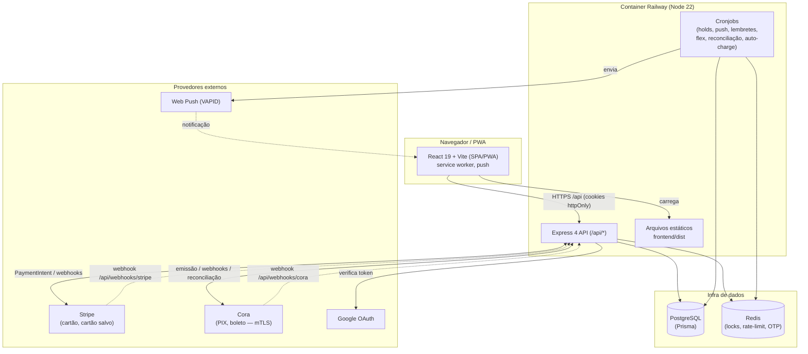

# Arquitetura

## Visão geral

O sistema é um **monorepo** com dois workspaces npm:

- **`frontend/`** — SPA em React 19 + Vite 6, empacotada como **PWA** (instalável, com service worker e push). Em produção é servida como arquivos estáticos pelo próprio backend.
- **`backend/`** — API REST em Express 4 + TypeScript (ESM), com Prisma 7 sobre PostgreSQL e Redis para locks/rate-limit/OTP. Integra-se à **Stripe** (cartão) e à **Cora** (PIX/boleto). **Não há assinaturas Stripe**: a recorrência das parcelas no cartão é o `autoChargeJob` (diário, off-session, para o cliente com `User.autoChargeEnabled` e cartão de crédito padrão) — ver [pagamentos.md](pagamentos.md#cobrança-automática-e9).

Em produção (Railway), um **único container** roda o backend, que também serve o build estático do frontend e faz o fallback de rotas do React Router para `index.html`.

## Diagrama de contexto



## Camadas do backend

```
backend/src/
├── index.ts            # boot do Express: middleware, rotas, registro dos cronjobs
├── config/             # configuração tipada + catálogos (staffPermissions, notificationEventCatalog, businessConfigCatalog)
├── middleware/         # auth (JWT + revogação), permissions (papel/permissões da equipe lidos do banco), errorHandler
├── modules/            # features (cada uma com routes.ts + sub-arquivos)
│   ├── auth/  bookings/  contracts/  payments/  pricing/  stripe/  coupons/
│   ├── webhooks/  notifications/  reports/  finance/  users/  staff/
│   ├── integrations/  blocked-slots/  push/  ambient/
├── lib/                # serviços de domínio (pagamentos, Cora, Stripe, OTP, flexCredits, permissionRules, staffRecipients, etc.)
├── jobs/               # cronjobs (executados via setInterval no boot)
├── generated/prisma/   # cliente Prisma gerado (versionado)
├── scripts/            # utilitários (seedBusinessConfig, cleanupTestData)
└── utils/              # helpers (crypto, pricing)
```

Cada **módulo** expõe um `router` do Express montado sob um prefixo em `index.ts` (ex.: `/api/contracts`). Módulos maiores (bookings, contracts, pricing, payments, users, integrations) dividem os handlers em vários arquivos que compartilham o mesmo `router` (ex.: `contract.creation.ts`, `contract.lifecycle.ts`, `contract.payments.ts`).

A camada **`lib/`** concentra a lógica de negócio reutilizável. Destaque para `paymentEffects.ts`, a **fonte única de verdade** dos efeitos colaterais de um pagamento confirmado (ativar contrato, confirmar booking, liberar serviços, gerar notificações) — chamada tanto pelos webhooks quanto pela reconciliação. Veja [pagamentos.md](pagamentos.md).

## Camadas do frontend

```
frontend/src/
├── App.tsx             # rotas + guards (ProtectedRoute, StaffRoute, ClientRoute, CalendarRoute, SettingsSectionGuard) + layout
├── pages/              # uma página por rota (lazy-loaded)
├── components/         # componentes e modais reutilizáveis (auth/Can.tsx: mostra só para quem pode)
├── context/            # AuthContext (inclui refreshPermissions), UIContext, NavigationContext
├── hooks/              # usePermission, useServiceWorker, usePushSubscription, useBusinessConfig, ...
├── api/                # client HTTP (fetch com cookies + refresh automático + eventos de sessão)
├── config/             # nav.ts: menus e STAFF_ROUTE_ACCESS (permissão de cada rota da equipe)
├── constants/          # permissions (chaves, só tipagem), platforms, paymentMethods, adminMeta
├── styles/             # CSS
└── sw.ts               # service worker (Workbox via injectManifest; cacheia só GETs públicos)
```

As rotas e a divisão cliente/equipe estão em [`frontend/src/App.tsx`](../../frontend/src/App.tsx). Páginas são **lazy-loaded** e pré-carregadas em idle após o login (`preloadPages` carrega só as que o usuário pode abrir). Os guards:

- `ProtectedRoute` — exige usuário autenticado; envolve a página no `Layout`.
- `StaffRoute access={STAFF_ROUTE_ACCESS['/admin/...']}` — área administrativa para ADMIN e COLABORADOR; cliente volta ao `/dashboard` sem aviso; equipe sem a permissão volta ao `/dashboard` com aviso. A mesma tabela filtra o menu (`filterNav`).
- `ClientRoute` — páginas só do cliente (`/minhas-gravacoes`, `/meus-*`).
- `CalendarRoute` — `/calendar` para todo cliente; para a equipe, com `agendamentos.ver` ou `hoje.ver`.
- `SettingsSectionGuard` — cada `?sec=` de Configurações exige a sua permissão.

Papéis e permissões estão em [permissoes-equipe.md](permissoes-equipe.md).

## Fluxo de uma requisição

1. O frontend chama `/api/...` com **cookies httpOnly** (credenciais incluídas).
2. `helmet` (CSP em produção) e `cors` (origens permitidas) processam a requisição.
3. **Rate limiters** específicos (auth, otp, pagamentos, refresh) e o limitador geral `/api` (Redis) são aplicados.
4. O middleware `authenticate` valida o `accessToken` (e recusa sessão revogada); para a equipe, `requirePermission`/`requireAllPermissions`/`requireStaff`/`requireAdmin`/`requireRole` leem papel, situação e permissões **do banco** (`getActor`) e respondem 403 `PERMISSION_DENIED`, 401 `ACCOUNT_DISABLED` ou 503 `PERMISSIONS_UNAVAILABLE`.
5. O handler do módulo executa a lógica (Prisma + Redis + provedores) — inclusive as regras que dependem do corpo (`lib/permissionRules.ts`, antes de qualquer escrita) — e responde JSON.
6. Erros caem no `errorHandler` central.

## Decisões de arquitetura

- **Container único** servindo API + estáticos: simplifica deploy e CORS (mesma origem em produção). O fallback `app.get('*')` entrega o `index.html` para o React Router.
- **Redis como dependência forte**: além de cache, é usado para **locks distribuídos** (evitar booking duplicado e execução duplicada de cronjobs em múltiplas instâncias), **rate limiting global** e **OTP**.
- **Cliente Prisma versionado** (`generated/prisma`): garante build reprodutível no monorepo/Windows e no Docker. Detalhes e o gotcha de regeneração em [modelo-de-dados.md](modelo-de-dados.md).
- **Efeitos de pagamento centralizados** em `paymentEffects.ts`: webhook e reconciliação convergem para o mesmo código, evitando divergência de estado.
- **Permissões da equipe lidas do banco a cada requisição** (nov/2026): o JWT só diz quem é; papel, situação e permissões de ADMIN/COLABORADOR vêm do Postgres (`middleware/permissions.ts`), então rebaixar, tirar uma permissão ou desativar vale na hora, sem depender do Redis. O cliente não paga essa consulta. Toda rota nova precisa de guarda e de uma linha na tabela da verdade dos testes ([permissoes-equipe.md](permissoes-equipe.md#testes-e-a-regra-rota-nova)).

## Relacionado

- [Setup de desenvolvimento](setup-dev.md) · [Modelo de dados](modelo-de-dados.md) · [API](api.md) · [Permissões da equipe](permissoes-equipe.md) · [Deploy](deploy.md)
