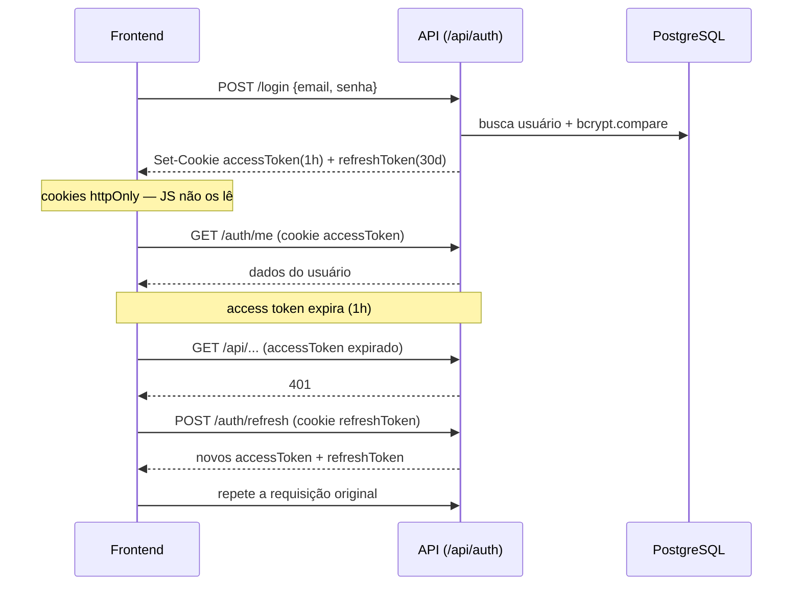

# Autenticação

Autenticação por **JWT em cookies httpOnly**, com refresh automático. Implementação em [`backend/src/modules/auth/routes.ts`](../../backend/src/modules/auth/routes.ts) e no middleware [`backend/src/middleware/auth.ts`](../../backend/src/middleware/auth.ts).

## Tokens

| Token | Validade (default) | Cookie | Observações |
| --- | --- | --- | --- |
| `accessToken` | `1h` (`JWT_ACCESS_EXPIRY`) | httpOnly, `SameSite=Lax`, `Secure` em produção | usado em toda requisição autenticada |
| `refreshToken` | `30d` (`JWT_REFRESH_EXPIRY`) | httpOnly, **path restrito** a `/api/auth/refresh` | renova o access token |

Assinatura HS256 com `JWT_SECRET` / `JWT_REFRESH_SECRET` (obrigatórios em produção — o boot falha sem eles; em dev caem para `dev-secret`/`dev-refresh-secret` com aviso).

## Formas de entrar

1. **E-mail + senha** — `POST /api/auth/login` (bcrypt, custo 12).
2. **Código no e-mail (OTP)** — cadastro: `POST /api/auth/register/send-code` → `POST /api/auth/register` (valida o código; cria sempre CLIENTE). Login sem senha: `POST /api/auth/login/send-code` → `POST /api/auth/login/verify-code`. É o caminho de quem foi criado sem senha (cliente cadastrado pela equipe, membro da equipe criado sem senha provisória).
3. **Google OAuth** — `POST /api/auth/google` (verifica o ID token ou valida o access token). Por segurança, **não** há vínculo automático de uma conta Google a um e-mail já existente com senha (evita account takeover). Conta existente **sem** senha só é vinculada se o Google informar o e-mail como verificado (`email_verified`); senão 409 `GOOGLE_EMAIL_NOT_VERIFIED`.

O e-mail é sempre gravado em minúsculas, e as buscas por e-mail (login, cadastro, Google, tela Equipe, cadastro de cliente) não diferenciam maiúsculas.

## Papéis e o usuário da sessão

Papéis: `CLIENTE`, `COLABORADOR` e `ADMIN` (ver [permissoes-equipe.md](permissoes-equipe.md)). Todas as respostas de auth que devolvem o usuário (login, código, Google, cadastro, refresh, `/me`, perfil, foto) usam o mesmo formato, com `permissions: string[]` (ADMIN = todas as chaves; COLABORADOR = as dele; CLIENTE = `[]`) e `staffTitle` (cargo). O `staff_profiles` só é lido para a equipe. Se a leitura falhar (tabela ausente, banco fora), o ADMIN entra com acesso total e `staffTitle: null`; o COLABORADOR **nunca** recebe sessão com `permissions: []`:
- login por senha e Google → **503** `{ code: 'PERMISSIONS_UNAVAILABLE', error: 'Não foi possível entrar agora: as permissões do seu acesso não puderam ser carregadas. Tente novamente em instantes.' }`; login por código → o mesmo 503, pedindo "um novo código" (a conferência já consumiu o código);
- `POST /auth/refresh` → 503 `SESSION_REFRESH_UNAVAILABLE`; `GET /auth/me` → 503 `PERMISSIONS_UNAVAILABLE`;
- nenhum desses 503 envia Set-Cookie; `PATCH /profile` e `POST /profile/photo`, que já gravaram, respondem 200 **sem** `permissions`/`staffTitle` (o front mantém as que tinha).

**Conta bloqueada ou desativada** (`clientStatus = BLOCKED`): login, código, Google e refresh respondem **403** `{ code: 'ACCOUNT_DISABLED', error }`; `GET /me`, `PATCH /profile` e `POST /profile/photo` respondem **401** com o mesmo corpo. Para a equipe, `error` = "Seu acesso foi desativado. Fale com o administrador."; o cliente mantém "Sua conta está bloqueada. Entre em contato com o estúdio.". Nas rotas da equipe o `getActor` relê papel e situação do banco a cada requisição e também responde 401 `ACCOUNT_DISABLED`.

**Senha:** cliente ≥ 6 caracteres; equipe ≥ 8 (`PATCH /auth/profile` → 400 `PASSWORD_TOO_SHORT`; tela Equipe → "Definir senha"). `role` no `PATCH /auth/profile` → 400 `ROLE_NOT_ALLOWED`. Quando alguém da equipe troca a própria senha, as **outras** sessões são encerradas e esta recebe cookies novos (a conta é relida antes: se foi desativada durante a troca, nenhum cookie sai). A senha de um cliente só o ADMIN define.

**Erro inesperado no login por senha e no `PATCH /auth/profile`** (ex.: banco fora ao ler o usuário): a própria rota responde **500** `{ error: 'Não foi possível concluir agora. Tente novamente em instantes.' }` e registra o erro no log (`[AUTH] login error:` / `[AUTH] profile update error:`). Antes o `catch` relançava o erro e, no Express 4, a requisição ficava sem resposta. Os 400 de validação e o 409 de CPF/CNPJ repetido continuam iguais; o 500 do login não envia Set-Cookie.
- **`POST /auth/google`** em duas fases: falha na **verificação do token** (assinatura, audience, tokeninfo/userinfo, inclusive a rede do Google) continua **401** "Falha na autenticação via Google." (ou os 401 próprios de token inválido/não autorizado); erro **depois** de o token ser aceito (conta no banco, sessão) → o mesmo **500** genérico, com o log `[AUTH:Google] login error:` e sem Set-Cookie. Corpo sem `idToken` → 400 "Dados inválidos.".
- **`PATCH /auth/profile` com a senha já gravada**: se algo falha depois de gravar a senha nova (na prática, a releitura da conta antes de reemitir os cookies da equipe), a resposta é **500** `{ code: 'PASSWORD_CHANGED', error: 'Sua senha foi alterada, mas não foi possível renovar o seu acesso agora. Se você for desconectado, entre com a nova senha.' }`, sem Set-Cookie (log `[AUTH] profile: senha gravada, falha depois:`). A senha e o resto do perfil já valem; se a revogação das sessões foi gravada, esta sessão cai na próxima requisição (`SESSION_REVOKED`). Falha **antes** de gravar continua com o 500 genérico, sem mudar nada.

## Fluxo de sessão (login + refresh)

No frontend, o client HTTP ([`frontend/src/api/client.ts`](../../frontend/src/api/client.ts)) envia `credentials: 'include'`, e ao receber **401** tenta `/auth/refresh` uma vez (o refresh devolve também o `user` atualizado). Na inicialização, chama `/auth/me` para restaurar a sessão — por isso a sessão (e o PWA instalado) **persiste ~30 dias**. Um erro do `/me` no boot que não encerra a sessão (ex.: 503) deixa sem usuário: a tela de login aparece e os cookies ficam. Assim, um COLABORADOR com as permissões ilegíveis cai no login, que responde o 503 acima com a mensagem.

### Respostas do `POST /auth/refresh`

401 só quando a sessão acabou; falha passageira é 503 e **não** apaga o cookie (com o banco de volta, o mesmo refresh token renova). Nenhuma recusa envia Set-Cookie.

| Situação | Resposta |
| --- | --- |
| sem cookie | 401 "Refresh token não encontrado." |
| token que não passa no `jwt.verify` (qualquer erro: assinatura, formato, expirado, payload que não é JSON) ou sem `userId` | 401 "Refresh token inválido ou expirado." |
| usuário inexistente | 401 "Usuário não encontrado." |
| conta bloqueada / excluída | 403 `ACCOUNT_DISABLED` / 401 "Conta não encontrada." |
| token anterior a uma revogação | 401 `{ code: 'SESSION_REVOKED', error: 'Sessão encerrada. Faça login novamente.' }` |
| erro de banco ou inesperado (inclusive as permissões do COLABORADOR ilegíveis) | **503** `{ code: 'SESSION_REFRESH_UNAVAILABLE', error: 'Não foi possível renovar a sessão agora. Tente novamente em instantes.' }` |

O resultado do refresh decide o que acontece:
- **renovou** → repete a requisição original;
- **recusou** (401/403 em JSON: sessão revogada, token inválido ou ausente) → evento `auth:session-ended`: com sessão na tela, o `AuthContext` desliga o push do aparelho, chama `/auth/logout` (apaga o cookie de refresh), limpa os caches da API e leva a `/login` com "Sua sessão terminou. Entre novamente."; no boot, só faz o logout quando havia cookie;
- **falha passageira** (rede, 5xx/503, 429 do limitador, 401/403 sem JSON) → `ApiError` 503 `SESSION_REFRESH_UNAVAILABLE`; o usuário é mantido.
- `code: 'ACCOUNT_DISABLED'` (em qualquer rota ou no refresh) → logout com "Seu acesso foi desativado. Fale com o administrador.", sem tentar refresh.
- 403 `PERMISSION_DENIED` → o front recarrega as permissões (`refreshPermissions`, separado do `fetchUser`; não desloga em erro de rede/503).

O logout normal também cancela a inscrição de push do aparelho (`DELETE /api/push/unsubscribe`) antes de `/auth/logout`. O service worker só cacheia os GETs públicos (`/api/pricing`, `/api/pricing/business-config/public`, `/api/pricing/payment-methods`, `/api/pricing/addons`, no cache `api-public-cache`), nunca `/api/auth/*` nem rotas autenticadas; os caches da API são apagados no login e no logout.

## Revogação de sessão

`revokeUserSessions(userId)` ([`middleware/auth.ts`](../../backend/src/middleware/auth.ts)) grava `auth:revoked:<userId>` no Redis com o instante da revogação. O `authenticate` recusa (401 `{ code: 'SESSION_REVOKED', error: 'Sessão encerrada. Faça login novamente.' }`) todo access token com `iat` ≤ esse instante, e o `POST /auth/refresh` recusa com o mesmo corpo o refresh token anterior a ele.

- **TTL = validade do refresh token (30 dias) + 60 s** (`revocationTtlSeconds()`). Antes a chave vivia só a validade do access token (1 h), e o refresh antigo voltava a renovar a sessão uma hora depois de uma troca de senha. Uma revogação posterior sobrescreve a chave sem encurtar a cobertura.
- Quem revoga: excluir ou bloquear cliente; trocar o e-mail de login ou definir a senha de um cliente; tela Equipe (papel ou e-mail mudou, "Definir senha", "Desativar"); a equipe trocando a própria senha (as outras sessões).
- Redis fora ou lento (> 500 ms) → fail-open: a checagem é pulada. Conta BLOCKED ou excluída continua recusada pelo banco (login, refresh, `getActor`); uma troca de senha ou de e-mail depende da chave no Redis (um `FLUSHDB` ou restart sem persistência a apaga).
- **Exclusão de cliente que falha** (ex.: 409 com cartão em processamento) desfaz só a revogação provisória que ela gravou, devolvendo a chave ao estado anterior (`readUserSessionRevocation` antes, `clearUserSessionRevocation` com Lua atômico depois): havia revogação → volta o valor anterior com a validade que restava (uma troca de senha anterior continua valendo); não havia → a chave é apagada; outra revogação feita no meio da exclusão → fica; o Redis não pôde ser lido antes → a revogação provisória fica (o cliente entra de novo).

## OTP

Implementado em [`backend/src/lib/otp.ts`](../../backend/src/lib/otp.ts), apoiado no Redis:

- Código de **6 dígitos**, expira em **5 minutos**.
- **Cooldown** de reenvio (anti-spam).
- **Lockout** após 5 tentativas erradas (~30 min). O contador de falhas **não** é zerado ao gerar um novo código (evita bypass).
- Em dev, `ALLOW_OTP_BYPASS=true` aceita o código `999999` (bloqueado em produção, com aviso no boot).

## Middleware

- `authenticate` — lê o `accessToken` do cookie, valida, recusa token revogado e injeta `req.user` (`userId`, `email`, `role` do JWT).
- [`middleware/permissions.ts`](../../backend/src/middleware/permissions.ts) — `getActor` (para quem não é CLIENTE no JWT, papel, situação e permissões vêm do **banco** a cada requisição; o papel do banco vence o do JWT), `requirePermission(...)` (qualquer uma), `requireAllPermissions(...)`, `requireStaff()`, `requireAdmin()` e `requireRole('CLIENTE')`. Respostas: 403 `PERMISSION_DENIED`, 401 `ACCOUNT_DISABLED`, 503 `PERMISSIONS_UNAVAILABLE`. Detalhes em [permissoes-equipe.md](permissoes-equipe.md).
- `authorize(...)` continua exportado, mas nenhuma rota o usa (o teste de invariantes de rotas proíbe).

No frontend ([`frontend/src/App.tsx`](../../frontend/src/App.tsx)):
- `ProtectedRoute` — exige usuário autenticado; envolve a página no `Layout`.
- `StaffRoute access={STAFF_ROUTE_ACCESS[...]}` — área administrativa (ADMIN e COLABORADOR); o cliente volta ao Painel sem aviso; a equipe sem a permissão volta ao Painel com "Você não tem acesso a essa área. Voltamos para o painel.".
- `ClientRoute` — `/minhas-gravacoes` e `/meus-*`, só CLIENTE ("Essa página é da área do cliente.").
- `CalendarRoute` — `/calendar`: o cliente sempre entra; a equipe precisa de `agendamentos.ver` ou `hoje.ver`.
- `SettingsSectionGuard` — `?sec=` de Configurações: seção proibida leva à primeira liberada, com aviso.

## Rate limiting

Endpoints de auth têm limites dedicados (ver [api.md](api.md#rate-limits)): login/register 15/15min, refresh 60/15min, envio de código 5/15min — todos via Redis (globais entre instâncias). O "Enviar acesso" da tela Equipe tem 10/15min por IP.

## Endurecimentos aplicados

- Sem auto-vínculo Google → e-mail existente com senha (exige login com senha primeiro); conta sem senha só com `email_verified`.
- Trocar o e-mail de login (cliente ou colaborador) desfaz o vínculo com o Google (`googleId = null`); no colaborador, apaga também a senha.
- bcrypt custo 12.
- Sanitização do `userId` no caminho de upload de foto (evita path traversal).
- OTP: contador de falhas preservado entre códigos; lockout temporário.
- Erros internos do Google auth não vazam para o cliente.

## Relacionado

- [API](api.md) · [Permissões da equipe](permissoes-equipe.md) · [Pagamentos](pagamentos.md)
