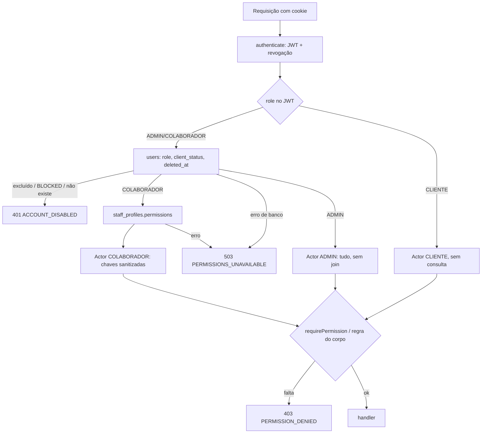

# Equipe e permissões por módulo

Separação entre **clientes** e **equipe** e o papel **COLABORADOR**, que entra na área administrativa limitado às permissões que o administrador marcar na tela Equipe. Fonte das decisões: rodada "Equipe" de 04/11/2026 (Fase 1), com as correções da revisão adversarial da mesma rodada.

| Tipo | Onde entra | O que pode | Quem cria |
| --- | --- | --- | --- |
| `CLIENTE` | área do cliente | só os próprios dados | cadastro público ou equipe com `clientes.criar` |
| `COLABORADOR` | área administrativa | só as ações marcadas | só ADMIN, na tela Equipe |
| `ADMIN` | área administrativa | tudo, inclusive o que é exclusivo dele | só ADMIN, na tela Equipe |

- Identidade única em `users` (nenhuma FK muda). O que é só da equipe fica na tabela 1:1 `staff_profiles` (`title` = cargo, `permissions TEXT[]`).
- `/api/users` trata **só de CLIENTE**. A equipe é gerenciada em `/api/staff` (só ADMIN, papel lido do banco); contrato completo em [api.md](api.md#staff--apistaff-routes--só-admin).
- A mesma pessoa não é cliente e equipe com o mesmo e-mail (409 `EMAIL_IS_CLIENT`, sem diferenciar maiúsculas).

## Onde está cada peça

| Peça | Arquivo |
| --- | --- |
| Catálogo (chaves, rótulos, níveis, selos, dependências, perfis, seções de Configurações, grupos de business-config, avisos da equipe) | [`backend/src/config/staffPermissions.ts`](../../backend/src/config/staffPermissions.ts) |
| Middleware (`getActor`, `requirePermission`, `requireAllPermissions`, `requireStaff`, `requireAdmin`, `requireRole`, `can`) | [`backend/src/middleware/permissions.ts`](../../backend/src/middleware/permissions.ts) |
| Guarda das rotas mistas (cliente dono × equipe com a chave) | [`backend/src/modules/bookings/permissionGuards.ts`](../../backend/src/modules/bookings/permissionGuards.ts) (`requirePermissionIfStaff`) |
| Regras que dependem do corpo/estado (funções puras) | [`backend/src/lib/permissionRules.ts`](../../backend/src/lib/permissionRules.ts) |
| Destinatários dos avisos da equipe | [`backend/src/lib/staffRecipients.ts`](../../backend/src/lib/staffRecipients.ts) |
| API da tela Equipe | [`backend/src/modules/staff/`](../../backend/src/modules/staff/) (`routes.ts`, `staff.service.ts`, `staffMail.ts`) |
| Revogação de sessão | [`backend/src/middleware/auth.ts`](../../backend/src/middleware/auth.ts) (`revokeUserSessions`) |
| Migrations | `backend/prisma/migrations/20261104000000_add_role_colaborador/` e `20261104000100_add_staff_profiles/` |
| Front: chaves (só tipagem), `usePermission`/`<Can>`, menu e rotas | `frontend/src/constants/permissions.ts`, `hooks/usePermission.ts`, `components/auth/Can.tsx`, `config/nav.ts` (`STAFF_ROUTE_ACCESS`, `filterNav`), `App.tsx` (`StaffRoute`, `ClientRoute`, `CalendarRoute`, `SettingsSectionGuard`) |
| Front: espelhos de regras do servidor | `components/admin/bookings/bookingPermissions.ts` (transições de status), `components/admin/bookings/tierAccess.ts` (faixas que o plano cobre) e `components/admin/team/teamPermissions.ts` (dependências e níveis) |
| Tela Equipe | `pages/AdminTeamPage.tsx`, `components/admin/team/*`, `hooks/useAdminTeam.ts`, `styles/team.css` |

Rótulos, níveis e perfis chegam do servidor em `GET /api/staff/catalog`. Os testes que mantêm tudo isso em sincronia estão em [Testes](#testes-e-a-regra-rota-nova).

## Matriz de permissões

Níveis: **V** = "Ver", **E** = "Ver e editar", **T** = "Tudo, inclusive cancelar e excluir". O nível marca um conjunto pronto de caixas (cumulativo); se as caixas não batem com nenhum nível, o seletor mostra "Personalizado". O banco guarda só as chaves.

Selos: $ = mexe com dinheiro · ⚠⚠ = não tem volta · ⚠ = sensível · 👁 = o cliente vê isto.

| Módulo | Chave | Rótulo | Nível | Selo |
| --- | --- | --- | --- | --- |
| Agenda e Agendamentos | `agendamentos.ver` | Ver agenda e agendamentos (inclui o preço de cada sessão) | V | |
| | `agendamentos.criar` | Criar agendamento para cliente | E | |
| | `agendamentos.editar` | Mudar data, horário e status | E | |
| | `agendamentos.faltas` | Registrar falta ou não realizado (e remarcar avulso perdido) | E | |
| | `agendamentos.cancelar` | Cancelar sessão | T | ⚠ |
| | `agendamentos.excluir` | Excluir agendamento definitivamente | T | ⚠⚠ |
| Hoje | `hoje.ver` | Ver a operação do dia | V | |
| | `hoje.presenca` | Confirmar presença (check-in) | E | |
| | `hoje.gravacao` | Operar a gravação (iniciar, desfazer, finalizar, métricas) | E | |
| Clientes | `clientes.ver` | Ver clientes | V | |
| | `clientes.criar` | Cadastrar cliente | E | |
| | `clientes.editar` | Editar o cadastro do cliente | E | |
| | `clientes.acesso` | Alterar o acesso ao app do cliente (e-mail de login e bloqueio) | T | ⚠ |
| | `clientes.excluir` | Excluir cliente | T | ⚠⚠ |
| Contratos | `contratos.ver` | Ver contratos (inclui parcelas e valores) | V | |
| | `contratos.criar` | Criar e renovar contratos ¹ | E | |
| | `contratos.editar` | Editar, pausar e retomar contratos | E | |
| | `contratos.condicoes` | Mudar créditos, serviços e condições de pagamento | T | $ |
| | `contratos.cancelar` | Cancelar contrato | T | ⚠ |
| | `contratos.multa` | Decidir pedido de cancelamento (cobrar ou isentar multa) | T | $ |
| Cobranças | `cobrancas.cobrar` | Cobrar o cliente (PIX, boleto ou cartão digitado) | E | |
| | `cobrancas.cartao_salvo` | Debitar o cartão salvo do cliente | T | $ |
| | `cobrancas.baixa` | Marcar como pago, anular ou estornar (baixa manual) | T | $ |
| | `cobrancas.automatica` | Ligar ou desligar a cobrança automática do cliente | T | $ |
| Financeiro e receita | `financeiro.ver` | Ver o financeiro e a receita | V | |
| Cupons | `cupons.ver` | Ver cupons | V | |
| | `cupons.editar` | Criar, editar, ativar e excluir cupons | E | $ |
| Relatórios | `relatorios.ver` | Ver relatórios (receita só com "Financeiro e receita") | V | |
| Avisos e modelos de mensagem | `avisos.enviar` | Enviar aviso aos clientes | T | ⚠ 👁 |
| | `avisos.modelos` | Editar os textos das mensagens automáticas ² | T | ⚠ 👁 |
| Configurações (caixas, sem nível) | `config.gerais` | Gerais (aparece no site para os clientes) | — | ⚠ 👁 |
| | `config.horarios` | Horários & Grade | — | |
| | `config.precos` | Preços e regras (planos e pagamentos; sem taxas de gateway) | — | $ |
| | `config.politicas` | Políticas | — | |
| | `config.servicos` | Serviços | — | $ |
| | `config.pagamentos` | Formas de pagamento | — | $ |
| | `config.ambiente` | Ambiente | — | |
| | `config.gravacoes` | Gravações (plataformas) | — | |

¹ **Renovar exige também `cobrancas.baixa`**: a renovação cria o plano ativo sem nenhuma parcela (ver `POST /contracts/:id/renew` abaixo). ² **Só os avisos dos clientes**: os modelos dos avisos da equipe ("Equipe — …") só o ADMIN altera. As duas regras estão na descrição da ação no catálogo. Outras descrições que mudaram nesta rodada: `contratos.condicoes` = "Ajusta os créditos FLEX e os serviços do contrato (recalcula as parcelas futuras)."; `financeiro.ver` = a receita do mês aparece no painel só para quem também vê a Agenda, e a dos relatórios só para quem também tem `relatorios.ver`. Conserto 5 (TELA5-04) e rodada 7: as descrições de `agendamentos.cancelar`/`excluir` (sessão com cobrança em aberto só com a baixa), `agendamentos.editar` (reabrir sessão cancelada exige também a baixa), `cobrancas.baixa` ("…Exigida também ao cancelar sessão com cobrança em aberto e ao reabrir sessão cancelada."; saiu o "toda ação que anula cobrança em aberto", falso pelo D2), `contratos.editar` (pausar um Fixo com cobrança em aberto), `contratos.cancelar` e `contratos.multa` ("No avulso ou em gravação cobrada à parte, com cobrança em aberto, exige também “Marcar como pago, anular ou estornar”."), `clientes.excluir` (a chave de cada coisa anulada) e o perfil Recepção dizem quando outra chave é necessária.

**Exclusivas do ADMIN** (nunca aparecem para marcar; a UI mostra em cinza com "só o administrador"): `equipe.gerenciar` (`/api/staff`), `config.email` (grupo `email` e teste de SMTP), `config.integracoes` (`/api/integrations/*`), `config.taxas` (grupo `gateway` e histórico de taxas), `sistema.manutencao` (limpeza de add-ons órfãos) e qualquer chave de business-config fora do catálogo (grupo "outros"). Também são só do ADMIN, sem chave própria: definir a **senha de um cliente** e editar/desligar/restaurar/testar os **modelos dos avisos da equipe** (eventos de audiência `admin`).

**Dependências** (aplicadas no servidor ao salvar e travadas na UI):
- toda ação de agendamentos, hoje, clientes, contratos e cupons exige o `.ver` do módulo;
- `cobrancas.cartao_salvo` exige `cobrancas.cobrar`;
- `cobrancas.automatica` exige `clientes.ver` (o interruptor fica no perfil do cliente);
- avisos, `financeiro.ver`, `relatorios.ver`, `cobrancas.cobrar`, `cobrancas.baixa` e as caixas `config.*` não exigem nada.

**`hoje.ver` libera `GET /api/bookings` normalmente** (sem forçar a data de hoje) e abre a Agenda (`/calendar`): a agenda não é dado sensível para quem opera o estúdio.

**O que continua visível sem `financeiro.ver`:** o preço de cada sessão (Agenda/Agendamentos), as parcelas de cada contrato (Contratos) e o card "Pagamento" do perfil do cliente (com `clientes.ver`), porque sem eles não dá para operar. Some só a receita consolidada: tela Financeiro, "Receita do mês" do painel, KPI "Receita" de Agendamentos e a receita dos Relatórios (o servidor omite `summary.totalRevenue`, `tierBreakdown[].revenue` e `ranking[].revenue`, e o ranking passa a ser ordenado por sessões).

### Configurações: seção e grupo

| Seção (`?sec=`) | Grupo(s) de business-config | Permissão |
| --- | --- | --- |
| Gerais | `studio` | `config.gerais` |
| Horários & Grade | `schedule` (inclui chaves fora do catálogo, cujo grupo vem da linha do banco) | `config.horarios` |
| Preços e regras | `plans`, `payments` | `config.precos` |
| Políticas | `policies` | `config.politicas` |
| Serviços | — (rotas de add-ons) | `config.servicos` |
| Formas de pagamento | — (rotas de payment-methods) | `config.pagamentos` |
| Ambiente | `ambient` | `config.ambiente` |
| Gravações | `recordings` | `config.gravacoes` |
| E-mail | `email` | só ADMIN (`config.email`) |
| Integrações | — | só ADMIN (`config.integracoes`) |
| (taxas de gateway, dentro de Preços e regras) | `gateway` | só ADMIN (`config.taxas`) |

O `PUT /api/pricing/business-config` é **tudo ou nada**: cada grupo tocado exige a sua permissão (`requiredForBusinessConfig`); faltando alguma, 403 com `deniedGroups` e nada é gravado. O `GET` devolve só os grupos permitidos.

## Perfis modelo

Escolher um perfil só preenche as caixas. `avisos.modelos` não entra em nenhum perfil.

| Perfil | Chaves |
| --- | --- |
| Recepção / Atendimento | `agendamentos.ver/criar/editar/faltas/cancelar` · `hoje.ver/presenca` · `clientes.ver/criar/editar` · `contratos.ver/criar` · `cobrancas.cobrar` · `cupons.ver` |
| Operador de estúdio | `agendamentos.ver/faltas` · `hoje.ver/presenca/gravacao` · `clientes.ver` · `relatorios.ver` · `config.gravacoes` |
| Financeiro | `financeiro.ver` · `cobrancas.cobrar/cartao_salvo/baixa/automatica` · `contratos.ver/editar/condicoes/cancelar/multa` · `clientes.ver/editar` · `agendamentos.ver` · `relatorios.ver` · `cupons.ver/editar` |

A Recepção **não renova** plano (renovar exige também `cobrancas.baixa`); a descrição do perfil no catálogo avisa isso. Pelo mesmo motivo, ela não reabre sessão **cancelada** nem cancela sessão com **cobrança em aberto** (PENDING/FAILED), em qualquer status: anular cobrança é da baixa.

O seed de desenvolvimento cria `colab@studio.com` (senha `colab123`) com o perfil Recepção.

## O que cada permissão libera (API e tela)

ADMIN passa em tudo. "ou" = qualquer uma das chaves basta; "+" = as duas são exigidas.

| Chave | API (guarda ou regra) | Tela |
| --- | --- | --- |
| `agendamentos.ver` | `GET /bookings` (ou `hoje.ver`); `GET /blocked-slots`; `GET /users` (diretório mínimo) | Agenda, Agendamentos (lista e preço) |
| `agendamentos.criar` | `POST /bookings/admin`; `GET /contracts` (seletor de plano; ou `contratos.ver`); ficha completa em `GET /users`; `POST /coupons/validate` com `userId` | "+ Novo Agendamento"; clique no horário livre da Agenda |
| `agendamentos.editar` | `PATCH /bookings/:id`: data/horário, saídas de COMPLETED/FALTA/NAO_REALIZADO e de CANCELLED (**+ `cobrancas.baixa`**), →COMPLETED, →RESERVED, notas; `POST`/`DELETE /blocked-slots` | data e horário no Editar; status permitidos; notas e métricas; "Confirmar presença" por PATCH |
| `agendamentos.faltas` | `PATCH` →FALTA/NAO_REALIZADO, `statusReason`, `noShowJustified`; `PATCH /bookings/:id/makeup` (equipe) | Falta, Não realizado, "Justificar falta", "Remarcar" do avulso |
| `agendamentos.cancelar` | `PATCH` →CANCELLED; `DELETE /bookings/:id` (equipe) — sessão com cobrança em aberto, em qualquer status: **+ `cobrancas.baixa`** | "Cancelado" no status; Cancelar no Hoje (com cobrança em aberto e sem a baixa: indisponível, com a explicação) |
| `agendamentos.excluir` | `DELETE /bookings/:id/hard-delete` (com cobrança em aberto: **+ `cobrancas.baixa`**) | lixeira de Agendamentos |
| `hoje.ver` | `GET /bookings` | Hoje; Agenda |
| `hoje.presenca` | `PUT /bookings/:id/check-in`; `PATCH` RESERVED/HELD→CONFIRMED | Check-in / Confirmar presença (Hoje, painel, detalhe do contrato) |
| `hoje.gravacao` | `PUT /bookings/:id/start-recording`, `/undo-start-recording`, `/complete`; `PATCH` CONFIRMED gravando→COMPLETED; notas e métricas | Iniciar, Desfazer início, Finalizar gravação, Dados da transmissão |
| `clientes.ver` | `GET /users` (ficha), `GET /users/:id`, `GET /users/:id/payment-overview` (ou `financeiro.ver`, ou `cobrancas.automatica`) | Clientes, perfil (inclusive o card "Pagamento"), link do nome do cliente nas outras telas |
| `clientes.criar` | `POST /users` (sem senha) | "Novo Cliente" |
| `clientes.editar` | `PATCH /users/:id`: cadastro, Ativo↔Inativo, CPF/CNPJ já preenchido | lápis e campos de cadastro do perfil |
| `clientes.acesso` | `PATCH /users/:id`: e-mail de login, entrar/sair de BLOCKED; `POST /users` já BLOCKED | e-mail de login na edição; opção "Bloqueado" |
| `clientes.excluir` | `GET /users/:id/deletion-preview`, `DELETE /users/:id` (+ `contratos.cancelar` com contrato em andamento, + `contratos.multa` com pedido em análise ou multa em aberto, + `cobrancas.baixa` com cobrança em aberto de sessão, avulsa ou de contrato encerrado) | lixeira e Zona de perigo |
| `contratos.ver` | `GET /contracts`, `GET /contracts/:id` (equipe) | Contratos e detalhe |
| `contratos.criar` | `POST /contracts`, `POST /contracts/custom` e `/custom/check` (equipe); `POST /contracts/:id/renew` **+ `cobrancas.baixa`** | "Novo Contrato", "Contrato Personalizado"; "Renovar" (com a baixa) |
| `contratos.editar` | `PATCH /contracts/:id`: `endDate`, `contractUrl`, `paymentMethod`, status ACTIVE/COMPLETED/EXPIRED; `PATCH /:id/pause` (FIXO com cobrança em aberto numa gravação a cancelar: **+ `cobrancas.baixa`**) e `/resume` | Editar (término, link, forma, status); Pausar/Retomar |
| `contratos.condicoes` | `PATCH /contracts/:id`: `flexCreditsRemaining`, `boletoAllowed`, `addOns`; reabrir contrato CANCELLED (**+ `contratos.cancelar`**) | créditos FLEX no Editar; "Editar serviços" no detalhe |
| `contratos.cancelar` | `DELETE /contracts/:id`; `PATCH` →CANCELLED (com cobrança de sessão em aberto: **+ `cobrancas.baixa`**, ver [Cancelar o contrato](#cancelar-o-contrato-e-decidir-o-pedido)); reabrir CANCELLED (**+ `contratos.condicoes`**) | Cancelar contrato (travado, com o motivo, quando falta a baixa); "Cancelado" no Editar |
| `contratos.multa` | `POST /contracts/:id/resolve-cancellation` (com cobrança de sessão em aberto: **+ `cobrancas.baixa`**); também exigida em qualquer mudança de status ou `DELETE` de contrato em `PENDING_CANCELLATION` | Cobrar multa / Isentar multa (travados, com o motivo, quando falta a baixa) |
| `cobrancas.cobrar` | `GET /stripe/payment-methods/for-payment/:id`; `POST /stripe/create-payment`, `/installment-plans` (com `paymentId`), `/verify-payment`; `POST /payments/:id/simulate`; `GET /payments/:id/status` (ou `financeiro.ver`, ou `cobrancas.baixa`); CPF/CNPJ de cliente que ainda não tinha; `POST /bookings/admin` com `paymentMethod: 'BOLETO'` | "Cobrar o cliente agora" (Novo agendamento), "Cobrar"/"Cobrar agora" (contrato e multa), folha de cobrança |
| `cobrancas.cartao_salvo` | `create-payment` com `savedPaymentMethodId`; `for-payment` só lista cartões com ela (`canUseSavedCards`) | cartões salvos do cliente no checkout da equipe |
| `cobrancas.baixa` | `PATCH /payments/:id`; no `POST /bookings/admin`: "Confirmado" (PAID), `customPrice`, valor final zero e sessão de plano em faixa acima da do plano (cobrada; sem a baixa, 403 `TIER_NOT_ALLOWED`); valor zero em `POST /contracts` e `/custom`; `renew` (+ `contratos.criar`); no `PATCH /bookings/:id`: reabrir sessão CANCELLED (+ `agendamentos.editar`), cancelar sessão com cobrança em aberto (+ `agendamentos.cancelar`; também no `DELETE /bookings/:id`) e excluí-la (+ `agendamentos.excluir`), tirar de NAO_REALIZADO sem conferir crédito ou teto, mudar de faixa a sessão avulsa, de SERVIÇO ou cobrada (a de plano muda sem ela dentro da faixa do plano); cancelar o contrato ou decidir o pedido de cancelamento com cobrança de sessão em aberto (+ `contratos.cancelar` / `contratos.multa`), pausar o FIXO com cobrança em aberto numa gravação a cancelar (+ `contratos.editar`) e excluir cliente com cobrança em aberto de sessão, avulsa ou de contrato encerrado (+ `clientes.excluir`) | Marcar pago; "Confirmado" e preço no Novo agendamento; Renovar (com criar); horário de outra faixa no Editar; reabrir sessão cancelada; cancelar sessão com cobrança em aberto; cancelar contrato e decidir o pedido com cobrança de sessão em aberto |
| `cobrancas.automatica` | `PATCH /users/:id/auto-charge`; `payment-overview` | interruptor de cobrança automática no perfil |
| `financeiro.ver` | `GET /payments`, `/payments/summary`, `/finance/closing/:y/:m`; receita nos relatórios; `payment-overview` | Financeiro; "Receita do Mês" (com a agenda); KPI "Receita" de Agendamentos; receita dos Relatórios (com `relatorios.ver`) |
| `cupons.ver` | `GET /coupons`, `GET /coupons/:id`; `GET /users` (diretório mínimo) | Cupons |
| `cupons.editar` | `POST`, `PATCH`, `DELETE /coupons(/:id)` | Novo, Editar, Ativar/Desativar e Excluir cupom |
| `relatorios.ver` | `GET /reports/*` | Relatórios (sem receita e com CSV sem receita sem `financeiro.ver`) |
| `avisos.enviar` | `POST /notifications/admin/broadcast`; `GET /events` e `/broadcasts`; `GET /users` (diretório mínimo) | aba "Enviar aviso" de Avisos |
| `avisos.modelos` | `PUT`/`DELETE /notifications/admin/templates/:eventKey` e `POST …/test`, só de eventos dos **clientes**; `GET /events` (sem os eventos da equipe) | aba "Eventos" de Avisos |
| `config.*` | `GET`/`PUT /pricing/business-config` pelo grupo; `config.precos`: `PUT /pricing`; `config.servicos`: `GET /pricing/addons/all`, `PUT /pricing/addons`, `DELETE /pricing/addons/:key`; `config.pagamentos`: `GET /pricing/payment-methods/all`, `PUT /pricing/payment-methods`, `PUT /pricing/payment-methods/boleto` | a seção correspondente de Configurações |

`GET /users` (diretório mínimo `{ id, name, email, role }`) abre com `clientes.ver`, `agendamentos.ver`, `contratos.ver`, `cupons.ver` ou `avisos.enviar`; a ficha completa (CPF, situação, etiquetas, totais) só vai para quem tem `clientes.ver`, `agendamentos.criar`, `contratos.criar` ou `cobrancas.cobrar`.

## Como a permissão é aplicada



- Papel e permissões da equipe são lidos **do banco a cada requisição** (memo em `req.actor`). Mudar permissões, rebaixar ou desativar vale na hora, mesmo com o Redis fora do ar.
- O cliente continua sem consulta: o JWT diz CLIENTE → nenhuma permissão.
- ADMIN não faz join em `staff_profiles` (se a migration da tabela falhar, o administrador continua entrando).
- `requireRole('CLIENTE')` protege o autoatendimento (`POST /bookings`, `/bookings/bulk`, `/contracts/self`, `/contracts/service`, `POST /stripe/setup-intent`, `PUT /stripe/auto-charge`): o ADMIN **não** passa (ao contrário de `requirePermission`).
- `requirePermissionIfStaff(...)` (rotas mistas): o cliente segue o ramo dele (só os próprios dados); a equipe precisa da chave, senão 403 (nunca cai no ramo do cliente).
- Routers 100% administrativos (`finance`, `reports`, `blocked-slots`, `integrations`, `notifications/admin`, `coupons` de gestão) têm `router.use(authenticate, requireStaff())` e a permissão fina por rota; `/api/staff` tem `router.use(authenticate, requireAdmin())`.
- No front, esconder botão é conforto: quem protege é o servidor. Um 403 `PERMISSION_DENIED` faz o front recarregar as permissões (`refreshPermissions`, no máximo 1 vez a cada 10 s; aviso só quando a ação recusada não era leitura), e as guardas de rota tiram a pessoa da tela que deixou de ser permitida.

### Regras que dependem do corpo (`lib/permissionRules.ts`)

Todas **negam por padrão**: campo do schema zod sem regra exige o ADMIN. O teste unitário confere que toda chave dos schemas tem regra. Só conta campo cujo **valor muda** em relação ao registro atual.

**`PATCH /api/bookings/:id`** (`requiredForBookingPatch`), por transição de status (a guarda da rota exige ao menos uma de `agendamentos.editar|faltas|cancelar`, `hoje.presenca` ou `hoje.gravacao`):

| De → para | Exige |
| --- | --- |
| RESERVED/HELD → CONFIRMED | `hoje.presenca` **ou** `agendamentos.editar` |
| sair de COMPLETED, FALTA ou NAO_REALIZADO | `agendamentos.editar` (+ `agendamentos.faltas` se envolve NAO_REALIZADO) |
| sair de CANCELLED | `agendamentos.editar` **e** `cobrancas.baixa` (+ `agendamentos.faltas` se vai para NAO_REALIZADO): o cancelamento anulou a cobrança da sessão e dos extras e liberou crédito ou vaga |
| CONFIRMED com gravação iniciada → COMPLETED | `hoje.gravacao` **ou** `agendamentos.editar` |
| outros → COMPLETED | `agendamentos.editar` |
| → FALTA / NAO_REALIZADO | `agendamentos.faltas` |
| → CANCELLED | `agendamentos.cancelar` (sessão com cobrança em aberto: **+ `cobrancas.baixa`**, regra do handler abaixo) |
| → RESERVED | `agendamentos.editar` |

Além disso:
- data ou horário alterado → `agendamentos.editar`. Se o novo horário (ou a nova data com o mesmo horário) cai em **outra faixa de preço** que `tierApplied`, sem `cobrancas.baixa`:
  - **sessão de plano** (contrato FIXO, FLEX ou Personalizado e nenhuma cobrança dela com a marca `metadata.sessionCharge`, em qualquer status): muda dentro da faixa do plano ou abaixo (`canAccessTier`, a mesma regra da criação), sem criar cobrança; acima → 403 `TIER_NOT_ALLOWED` ("O plano Comercial não permite agendar horários Audiência.");
  - **demais** (avulso pago ou não, SERVIÇO, FIXO extra, sessão vinculada que nasceu cobrada): 403 `cobrancas.baixa` com mensagem própria, porque a cobrança já emitida não é reprecificada;
- `statusReason` alterado ou `noShowJustified` presente → `agendamentos.faltas`; notas, links e métricas alterados → `hoje.gravacao` **ou** `agendamentos.editar`;
- reenviar o mesmo horário não recalcula o preço (antes o preço personalizado ou com desconto era sobrescrito);
- **sair de CANCELLED** sem `cobrancas.baixa` → 403 `permission: 'cobrancas.baixa'` (sem `agendamentos.editar`, o 403 é o do editar). O texto depende do que a sessão tem (`reopenCancelledNeedsBaixaText`, `booking.service.ts`):
  - **cobrança própria viva** (a cobrança da gravação PAID, PENDING ou FAILED: a marcada `sessionCharge`; no avulso sem a marca, a que não é compra de extra): "Reabrir uma sessão cancelada exige a permissão “Marcar como pago, anular ou estornar”. Esta sessão já tem cobrança própria: peça a quem tem essa permissão para reabri-la. Não crie um novo agendamento — o cliente seria cobrado de novo.";
  - alguma cobrança dela **anulada** (CANCELLED): "Reabrir uma sessão cancelada exige a permissão “Marcar como pago, anular ou estornar”: a cobrança dela foi anulada no cancelamento. Para uma nova sessão, crie um novo agendamento.";
  - **nenhuma cobrança** (sessão de plano sem extras): "Reabrir uma sessão cancelada exige a permissão “Marcar como pago, anular ou estornar”. Para uma nova sessão, crie um novo agendamento.";
- **voltar a ficar em aberto com a cobrança PRÓPRIA anulada** (conserto 5 — AUDFIN-01/ATU5-01/TELA5-01; rodada 7 — AUDFIN6-02; vale para **todos, inclusive o ADMIN**, depois da trava DIN-01, antes do desconto de crédito do Não realizado e de qualquer escrita): desde a R5 o cancelamento anula a cobrança em aberto da sessão, também a do avulso; CANCELLED é terminal e nenhuma rota reemite a cobrança de uma sessão. `ownSessionChargeState` (`sessionPayment.ts`) = `'voided'` quando nenhuma cobrança própria (a marcada ou, no avulso sem a marca, a que não é extra) está PAID/PENDING/FAILED e alguma está CANCELLED (anulada no cancelamento ou perdoada pelo `PATCH /payments`; o 409 não distingue). Destino aberto (RESERVED/HELD/CONFIRMED) vindo de **qualquer status fechado** (CANCELLED, COMPLETED, FALTA, NAO_REALIZADO) → 409 `SESSION_CHARGE_VOIDED` ("A cobrança desta sessão foi anulada e não volta com a reabertura, então ela não pode voltar a ficar em aberto (Reservado, Em espera ou Confirmado) sem cobrança. Para gravar, crie um novo agendamento: ele gera a cobrança de novo."). Antes da rodada 7 só a saída de CANCELLED era barrada, e Cancelado → Concluído → Confirmado (o 2º passo só com `agendamentos.editar`) deixava a gravação em aberto sem cobrança. Entre status em aberto (Reservado → Confirmado, check-in) nada muda. CANCELLED → COMPLETED/NAO_REALIZADO passam e a resposta traz `reopenedWithoutCharge: true` e "A cobrança desta sessão foi anulada e não volta com a reabertura: a sessão fica sem cobrança." na `message` (a tela mostra o aviso "Sessão reaberta sem cobrança", também quando o Não realizado passa pelo modal de motivo). Não se recria cobrança (decisão de produto, ver [Pendências](#pendências-para-o-dono));
- **cancelar sessão com cobrança em aberto** (R5 — anular cobrança é da baixa): `PATCH` → CANCELLED, `DELETE /bookings/:id` (equipe) e `DELETE /bookings/:id/hard-delete` de uma reserva com algum Payment PENDING/FAILED, em **qualquer** status, data ou gravação, sem `cobrancas.baixa` → 403 `OPEN_CHARGE_CANCEL_NEEDS_BAIXA` (`booking.service.ts`): `{ code: 'PERMISSION_DENIED', permission: 'cobrancas.baixa', error: 'Esta sessão tem cobrança em aberto: cancelar anula a cobrança, e isso exige a permissão “Marcar como pago, anular ou estornar”. Peça a quem pode dar baixa ou, se o cliente faltou, use Falta (a cobrança continua devida).' }` (a exclusão — TELA5-05 — tem o mesmo `code`/`permission` com texto próprio, `OPEN_CHARGE_DELETE_NEEDS_BAIXA`: "Esta sessão tem cobrança em aberto: excluir anula a cobrança, e isso exige a permissão “Marcar como pago, anular ou estornar”. Peça a quem pode dar baixa."). Vem depois da regra da tabela (quem não tem `agendamentos.cancelar` recebe o 403 dele) e antes de qualquer escrita. Motivo: cancelar ou excluir chama `voidExtrasOfCancelledBooking`, que anula toda cobrança em aberto da reserva (a da própria sessão, inclusive a do avulso, e a dos extras); marcar Falta não anula nada. Substitui a trava "sessão que já aconteceu" do conserto 3, que reabrir ou remarcar antes de cancelar furava: reabrir e remarcar continuam permitidos (o E11 ainda zera o início ao remarcar), mas o cancelamento seguinte recebe o mesmo 403 enquanto a cobrança estiver em aberto. Corrida: sem a baixa, a transição só grava se a reserva continua sem cobrança em aberto (`NO_OPEN_CHARGE_BOOKING_WHERE`) e é reconferida logo depois (uma cobrança que apareceu no meio desfaz a transição e dá o 403); quem não tem a baixa nunca chama a anulação; no hard-delete, a exclusão vem primeiro, com a mesma condição. Sem cobrança em aberto, segue como antes. ADMIN, quem tem a baixa, o cliente na própria reserva e os jobs não mudam;
- **sair de NAO_REALIZADO** (para qualquer status menos CANCELLED) sem `cobrancas.baixa`: o "Não realizado" devolveu o crédito (e tirou a sessão do teto do FIXO), e esse crédito ou vaga pode já ter sido usado ou, no FLEX, vencido no confisco semanal. FLEX, Personalizado e AVULSO descontam o crédito **antes** de mudar o status (sem crédito → 409 `NO_CREDITS` "O plano não tem crédito disponível para reabrir esta sessão: o crédito devolvido no “Não realizado” já foi usado ou venceu. …", nada muda; perdendo a corrida, o crédito volta); o FIXO confere o teto sob a trava `booking:fixo-cap:<id>` (cheio → 409 `FIXO_LIMIT_REACHED`), **menos** na sessão EXTRA (marca `fixoExtra` — criada com o teto já cheio —, em qualquer status, inclusive anulada: a extra não ocupa vaga do plano — ver [Teto do FIXO](#pagamento-da-sessão-e-teto-do-fixo)). A sessão cobrada por quem tem a baixa dentro do teto (só `sessionCharge`) ocupa vaga e passa pela conferência. O ADMIN e quem tem a baixa seguem como antes (desconto sem conferir, sem teto);
- com a baixa (ou ADMIN), a sessão **CANCELLED de plano Personalizado** não sai de CANCELLED; a de **FLEX** só volta a COMPLETED (desfazer o "Cancelar" de uma sessão que aconteceu: o saldo é recalculado na hora com a conta do cron, `reconcileFlexCredits`). Os outros destinos dão 409 `PLAN_SESSION_CANCELLED` (**vale também para o ADMIN**); CANCELLED → FALTA continua 400 para todo tipo de contrato. Para uma sessão nova, o caminho é um novo agendamento, que consome 1 crédito. O saldo do Personalizado (`customCreditsRemaining`) não tem campo na tela nem na API: o acerto é só pelo [runbook](#runbook-m8).

O front filtra as opções de status com o espelho `bookingPermissions.ts` (mesma tabela; o `eq-integracao-sync` quebra se divergirem) e já esconde as saídas de CANCELLED do Personalizado e, no FLEX, todas menos Concluído. Sem a baixa, a sessão cancelada fica só com "Cancelado". Quando a baixa é o **único** requisito que falta (o acesso tem `agendamentos.editar` — UXT-01), a lista mostra o selo com uma dica (hover ou foco) e o Editar mostra o mesmo texto: `cancelledReopenNeedsBaixaHint` não afirma que a cobrança foi anulada nem manda criar outro agendamento sem ressalva (com `openChargeCount` 0 a tela não distingue paga de anulada). O texto do avulso ("a cobrança desta sessão continua valendo") só aparece com `openChargeCount` > 0 (TELA5-03: o legado de antes da R5; desde a R5 o cancelamento anula a cobrança em aberto do avulso). Sem `agendamentos.editar` (ex.: Operador de estúdio), o selo é simples. Falta a partir de Concluído ou Cancelado não é oferecida (`isFaltaRefused`: o servidor responde 400 para todos). O 409 `SESSION_CHARGE_VOIDED` tem espelho só quando o servidor já disse (rodada 7, `isVoidedChargeReopenBlocked`, regra para todos): o `GET /bookings` não traz o estado da cobrança própria, então a lista marca a linha (`ownChargeVoided`) quando recebe `reopenedWithoutCharge` ou o 409; daí Reservado/Em espera/Confirmado somem do seletor e o Editar explica com `VOIDED_CHARGE_REOPEN_HINT`. Sem a marca (página recarregada, Hoje, Agenda), a tela oferece e mostra a mensagem do 409.

**Cancelar na tela (R5).** As rotas da equipe trazem `openChargeCount` (cobranças PENDING/FAILED da reserva). Com a contagem > 0 e sem a baixa, a tela não oferece o cancelamento (`cancelBlockedByOpenCharge`, `cancelNeedsBaixa` do hook) e mostra o texto do 403 (`CANCEL_OPEN_CHARGE_NEEDS_BAIXA`, igual ao do servidor, com teste de paridade): no Editar, "Cancelado" some e a explicação aparece abaixo dos status; na lista, "Cancelado" some do seletor e aparece o selo "Cancelar indisponível"; no Hoje, o botão Cancelar fica indisponível. Nos dois últimos, a dica aparece no mouse ou no foco, e o clique abre o mesmo texto. Sem a contagem (campo ausente), nada trava: o diálogo avisa "Se esta sessão tiver cobrança em aberto, cancelar exige a permissão “Marcar como pago, anular ou estornar”: sem ela, o cancelamento é recusado e a cobrança continua devida." e mostra o 403 do servidor se ele vier. O diálogo (`cancelBookingConsequences(b, { canSettleCharges })`, opção obrigatória) diz que a cobrança ainda em aberto é anulada; no avulso, "Nenhum pagamento já feito é estornado nem vira crédito para outro agendamento. A cobrança em aberto desta gravação deixa de ser devida." e nenhuma linha de "1 crédito volta" (o crédito que o servidor devolve ao micro-contrato não tem uso). No Flex, "1 crédito volta" só aparece para a sessão ainda por acontecer cuja semana com certeza não fechou (`flexSessionWeekSurelyOpen`), com a ressalva de que ele pode vencer; nos outros casos o texto diz que o saldo é recalculado pela conferência automática e que o crédito só volta se a semana não fechou ou se o cliente está adiantado no ritmo (senão é perdido), e no Não realizado avisa que a conferência pode confiscar 1 crédito. **Excluir (TELA5-05)**: com `openChargeCount` > 0, em qualquer status, e sem a baixa, a lixeira da lista fica travada (`hardDeleteBlockedByOpenCharge`, `hardDeleteNeedsBaixa` do hook), com o texto do 403 da exclusão (`HARD_DELETE_OPEN_CHARGE_NEEDS_BAIXA`, igual ao do servidor, com teste de paridade) na dica e no clique. O diálogo (`hardDeleteConsequences(b, { canSettleCharges })`) diz, para quem tem a baixa, que a cobrança em aberto é anulada antes de apagar; sem a baixa e sem a contagem, avisa que a exclusão pode ser recusada.

Na troca de faixa, o Editar decide com `tierChangeBlockedFor` (`tierAccess.ts`): a sessão de plano é comparada com a faixa do plano e as demais com `tierApplied`. Ele não enxerga a marca `sessionCharge`, então a sessão de plano cobrada à parte só é recusada pelo servidor. Os 409 `NO_CREDITS`/`FIXO_LIMIT_REACHED` e o 403 `TIER_NOT_ALLOWED` aparecem com o texto do servidor, sem recarregar as permissões.

**`POST /api/bookings/admin`** (`requiredForAdminBookingCreate`):
- sempre `agendamentos.criar`; o alvo precisa ser CLIENTE (404 "Cliente não encontrado.") e o plano informado precisa ser **do cliente** (404 "Contrato não encontrado para este cliente.");
- contrato vinculado fora de ACTIVE/COMPLETED (cancelado, expirado, aguardando pagamento, pausado, com cancelamento solicitado) → 400 `CONTRACT_NOT_ACTIVE` ("Não é possível agendar neste contrato: ele está …"), **para todos, inclusive o ADMIN**, antes de crédito, cobrança ou escrita;
- sem `cobrancas.baixa`, "Confirmado" é **rebaixado para Reservado** (não é 403): `downgraded: true` e `notice` na resposta;
  - **avulso**: cobrança PENDING do valor da sessão (aguardando pagamento);
  - **sessão de plano** (contrato FIXO, FLEX ou Personalizado; no FIXO, enquanto o teto meses × sessões/mês não foi usado): nenhuma cobrança da sessão (o plano já cobre); só os serviços extras (com o desconto do plano) viram uma cobrança PENDING, e sem extras nenhum Payment é criado. A resposta traz `coveredByPlan: true` e `message` própria ("…presença a confirmar…");
  - essa sessão de plano só vale num horário da **faixa do plano ou abaixo** (`canAccessTier`: Comercial < Audiência < Sábado); faixa acima → 403 `TIER_NOT_ALLOWED` ("O plano Comercial não permite agendar horários Audiência."), antes de crédito, trava ou escrita. Quem tem a baixa (e o ADMIN) agenda em faixa acima, cobrando pelo preço da faixa do horário com o desconto do plano;
  - **cobradas como antes** (PENDING do valor da sessão com o desconto do contrato, mais extras): contrato de **SERVIÇO**, contrato AVULSO existente e **FIXO com o teto já usado** (sessão extra). A `notice` explica ("…contrato de serviço não inclui gravação…" / "…o plano fixo já usou todas as sessões…"). O teto do FIXO é reconferido sob a trava do contrato: se encheu durante a criação, 409 `FIXO_LIMIT_REACHED` (na nova tentativa, a sessão sai cobrada). A cobrança da sessão criada com o teto cheio leva `metadata.fixoExtra: true` (conserto 5 — para todos: com a baixa, o teto é conferido sob a mesma trava só para decidir essa marca; a sessão que quem tem a baixa cria dentro do teto é cobrada, sem `fixoExtra`, e ocupa a vaga);
- `customPrice` diferente do preço padrão (faixa, ou faixa com o desconto do plano; inclusive 0) → `cobrancas.baixa`;
- valor final zero (cupom 100%), que seria liquidado como PAGO → 403 `cobrancas.baixa`, antes de gravar (não vale para a sessão de plano, que nunca liquida nada);
- `paymentMethod: 'BOLETO'` → `cobrancas.cobrar` (o servidor emite o boleto na hora); a checagem de disponibilidade do boleto (`BOLETO_UNAVAILABLE`) vem **depois** da permissão;
- contrato FLEX ou Personalizado → desconta 1 crédito (atômico); sem crédito, 400 `NO_CREDITS` e nada é gravado (vale para todos, inclusive o ADMIN);
- o RESERVED criado pela equipe **não expira** (não grava `holdExpiresAt`);
- a cobrança que inclui o valor da **própria sessão** (avulso, SERVIÇO, FIXO extra e toda sessão vinculada criada por quem tem a baixa, inclusive "Reservado" ou "Confirmado" do ADMIN) grava `metadata.sessionCharge: true`; a cobrança só dos extras de uma sessão coberta pelo plano não leva a marca. As reemissões (PIX, cartão, reabertura de FAILED) mesclam o metadata, então a marca fica.

**`PATCH /api/bookings/:id/confirm`** (cliente dono): a sessão que precisa de pagamento próprio (tem cobrança com a marca `sessionCharge`, é avulso ou está no prazo do hold) só se confirma com a **cobrança da sessão paga** (regra em [Pagamento da sessão](#pagamento-da-sessão-e-teto-do-fixo); um extra pago não conta). Senão, 402 "Pagamento obrigatório para confirmar agendamento avulso." (avulso) ou "Pagamento obrigatório para confirmar esta sessão." (SERVIÇO, FIXO extra, sessão vinculada criada como "Reservado" por quem tem a baixa). A sessão de plano sem cobrança própria continua confirmável mesmo com extras em aberto. Com a marca, só a cobrança marcada **em aberto** segura a sessão: marcada só anulada ou estornada por quem tem a baixa não deixa nada a pagar e a sessão confirma (conserto 5 — AUDFIN-02; antes era 402 para sempre; o aviso das 7h trata essa sessão como confirmada, também no avulso Reservado — rodada 7, TELA6-02). Pagar a cobrança da sessão confirma a sessão sozinho.

**Confirmação pelo pagamento** (ATU-02/FIN-08): pagar **outra** cobrança da reserva (um serviço extra do `POST /bookings/:id/addons`, uma parcela do contrato) não leva a sessão a CONFIRMED enquanto a cobrança da própria sessão não estiver paga. O `POST /bookings/:id/complete-payment` (registra o PAID e roda os efeitos, mas a sessão segue RESERVED e a mensagem diz que falta a cobrança dela) e a varredura dos holds (só limpa o `holdExpiresAt`, nas duas promoções) usam a mesma regra do `/confirm` (`sessionAwaitsOwnPayment`). O `confirmBookingAndActivateContract` (efeitos de todo pagamento confirmado) olha só a cobrança **marcada** em aberto (`openSessionChargeWhere`, `lib/sessionCharge.ts`). Além disso: o `POST /api/bookings` do cliente no horário de uma reserva dele **sem prazo** (`holdExpiresAt` nulo: feita pela equipe, ou sessão de plano) → 409 `BOOKING_ALREADY_RESERVED`, sem renovar hold nem criar cobrança (só o hold do avulso do próprio cliente é retomado); e o `POST /bookings/:id/addons` numa reserva com hold (avulso do cliente ainda no prazo de pagamento) → 409 `BOOKING_AWAITING_PAYMENT` ("Conclua o pagamento da reserva antes de contratar serviços extras."), porque os extras vão no checkout da reserva — a tela esconde "Adicionar serviço" nesse caso. Se a reserva deixa de aceitar extras enquanto a cobrança do extra é criada (foi cancelada ou excluída no meio), essa cobrança nova vira CANCELLED e a resposta é 409 `BOOKING_NOT_EDITABLE` ("Esta gravação não aceita mais serviços extras (foi cancelada ou alterada). Atualize a tela.").

**Autoatendimento (`POST /api/bookings`, só CLIENTE)**: contrato de SERVIÇO → 400 "Contrato de serviço não inclui gravação."; contrato AVULSO → 400 "Gravação avulsa não se agenda pelo contrato. Para remarcar, use a remarcação da própria reserva." (antes de faixa, trava ou escrita: o crédito que o cancelamento devolve ao micro-contrato do avulso não vira sessão sem cobrança); Personalizado sem crédito → 400 "Créditos esgotados neste plano."; o desconto do crédito (FLEX/Personalizado) é guardado: se outra reserva zerou o saldo no meio, 400 "Créditos esgotados (concorrência). Tente novamente." e nada é gravado. O `/bulk` só aceita FLEX.

**`PATCH /api/contracts/:id`** (`requiredForContractPatch`):
- status CANCELLED → `contratos.cancelar`; ACTIVE, COMPLETED ou EXPIRED → `contratos.editar`;
- contrato em `PENDING_CANCELLATION` + qualquer mudança de status → também `contratos.multa` (cancelar isenta a multa; reabrir recusa o pedido);
- contrato **CANCELLED** + qualquer mudança de status (reabrir) → também `contratos.cancelar` **e** `contratos.condicoes` (desfaz a decisão de cancelar e devolve créditos/sessões);
- `endDate`, `contractUrl`, `paymentMethod` → `contratos.editar`;
- `flexCreditsRemaining`, `boletoAllowed` → `contratos.condicoes`;
- `addOns` presente → `contratos.condicoes` (o handler reprecifica as parcelas futuras mesmo com a mesma lista);
- o status só é gravado se não mudou entre a leitura e a escrita; senão 409 `CONTRACT_STATUS_CHANGED`, sem efeito.

**`DELETE /api/contracts/:id`** (`requiredForContractCancel`): `contratos.cancelar` (+ `contratos.multa` em `PENDING_CANCELLATION`, relido sob a trava de cancelamento; + `cobrancas.baixa` com cobrança de sessão em aberto — ver [Cancelar o contrato](#cancelar-o-contrato-e-decidir-o-pedido)).

**`POST /api/contracts/:id/renew`**: `requireAllPermissions('contratos.criar', 'cobrancas.baixa')`, porque a renovação cria o plano ATIVO **sem nenhuma parcela**. Corpo validado por zod antes de qualquer leitura (`durationMonths` 3 ou 6, padrão 3; `type` FIXO|FLEX; `tier` do enum; `startDate` texto ou null) → 400 "Dados inválidos.".

**Contratos criados pela equipe** (`POST /contracts`, `/custom`): nascem ATIVOS com as parcelas em aberto (nunca `AWAITING_PAYMENT`); parcela de valor zero (cupom 100%) sem `cobrancas.baixa` → 403 (`permission: 'cobrancas.baixa'`), revertendo o que o pedido gravou; o `/custom` da equipe exige `userId` (400 `CLIENT_REQUIRED`) de um CLIENTE.

**`PATCH /api/users/:id`** (`requiredForUserPatch`, alvo já conferido como CLIENTE):
- `role: 'CLIENTE'` é aceito e ignorado; outro papel → 400 `ROLE_NOT_ALLOWED`;
- senha → só ADMIN (colaborador nunca define senha de cliente);
- e-mail alterado (sem diferenciar maiúsculas) e entrar/sair de BLOCKED → `clientes.acesso`; trocar o e-mail desfaz o vínculo com o Google (`googleId = null`), encerra as sessões do cliente e avisa o e-mail antigo;
- ACTIVE↔INACTIVE e demais campos de cadastro → `clientes.editar`;
- CPF/CNPJ de cliente que ainda não tinha → `clientes.editar` **ou** `cobrancas.cobrar` (o `CpfCnpjPrompt` do checkout);
- corpo sem nenhuma mudança → exige `clientes.editar`, `clientes.acesso` ou `cobrancas.cobrar`.

**`POST /api/users`** (`requiredForUserCreate`): `clientes.criar`; senha opcional e só ADMIN (sem senha, o cliente entra por código no e-mail); nascer BLOCKED → `clientes.acesso`.

**`PATCH /api/payments/:id`** (`requiredForPaymentPatch`): `cobrancas.baixa`.

**`POST /api/notifications/admin/broadcast`**: lista de ids só de CLIENTES não excluídos; qualquer outro id → 400 `INVALID_RECIPIENTS` com `invalidIds`, nada é enviado (vale também para o ADMIN).

### Cancelar o contrato e decidir o pedido

Cancelar o contrato (`DELETE /contracts/:id`, `PATCH` → CANCELLED) e decidir o pedido de cancelamento (`POST /contracts/:id/resolve-cancellation`, cobrando ou isentando a multa) anulam as cobranças em aberto do contrato (nunca a multa). A parte que é cobrança **de sessão** segue o princípio "anular é da baixa": sem `cobrancas.baixa`, 403 depois de reler o status sob a trava do cancelamento e antes de qualquer escrita (`contractCancelNeedsBaixa`, `contract.lifecycle.ts`; no `resolve-cancellation`, o pedido continua em análise). A conta é `contractCancelBaixaChargeWhere`:

- **AVULSO** (conserto 5 — ATU5-03; o contrato é a própria sessão): qualquer Payment PENDING/FAILED do contrato → `{ code: 'PERMISSION_DENIED', permission: 'cobrancas.baixa', error: 'Este avulso tem cobrança em aberto: cancelar o contrato anula a cobrança da sessão, e isso exige a permissão “Marcar como pago, anular ou estornar”. Peça a quem pode dar baixa.' }`;
- **SERVIÇO, FIXO, FLEX e Personalizado** (rodada 7 — AUDFIN6-01/ATU6-02): Payment PENDING/FAILED do contrato com `bookingId` **e** a marca `sessionCharge` (gravação vinculada a um SERVIÇO, sessão extra do FIXO, sessão cobrada à parte dentro do plano), inclusive a de uma gravação já feita → o mesmo `code`/`permission` com "Uma gravação deste contrato tem cobrança própria em aberto (a da sessão, cobrada à parte): cancelar o contrato anula essa cobrança, e isso exige a permissão “Marcar como pago, anular ou estornar”. Peça a quem pode dar baixa.";
- as **parcelas** (sem `bookingId`) e os **serviços extras** das sessões (sem a marca) continuam anulados só com `contratos.cancelar` / `contratos.multa` (D2). ADMIN e quem tem a baixa seguem como antes;
- `GET /contracts` traz `openSessionChargeCount` em cada contrato (a conta do 403; no avulso, igual a `openChargeCount`). A tela (`components/admin/contracts/contractCancelRules.ts`), sem a baixa e com a contagem > 0, trava "Cancelar contrato" e "Cobrar multa"/"Isentar" (cadeado, dica e o motivo no clique) e tira o Cancelado do Editar, que explica. Sem o campo, só o avulso usa `openChargeCount`; nos outros tipos nada trava e o diálogo avisa que o servidor pode recusar. No SERVIÇO, o diálogo diz que as gravações vinculadas futuras são canceladas; com a baixa e contagem > 0, que a cobrança própria em aberto das gravações também é anulada, mesmo a de gravação já feita;
- corrida conhecida: uma cobrança marcada criada entre a conferência e a anulação (o `POST /bookings/admin` não usa a trava do cancelamento) é anulada.

### Pagamento da sessão e teto do FIXO

Regras puras em `modules/bookings/sessionPayment.ts` (R5), as mesmas em todos os pontos abaixo:

- **Cobrança da sessão paga** (`sessionPaymentState`): com a marca `metadata.sessionCharge`, nenhuma cobrança marcada PENDING/FAILED e ao menos uma marcada PAID; sem a marca (avulso do próprio cliente, legado), um PAID que **não** seja compra de extra. O estado traz também `open` (alguma marcada PENDING/FAILED).
- **A sessão espera a cobrança própria** (`awaitsOwnPayment`; conserto 5 — AUDFIN-02): com a marca, só enquanto há marcada **em aberto** (a mesma regra de `confirmBookingAndActivateContract`); marcada só anulada ou estornada não deixa nada a pagar. Sem a marca, quando é avulso ou está no prazo do hold. Uma sessão **fechada** (Cancelado, Concluído, Falta, Não realizado) com a cobrança própria anulada não volta a ficar em aberto (409 `SESSION_CHARGE_VOIDED`, acima): só a sessão que já estava em aberto quando quem tem a baixa a perdoou fica confirmável sem nada a pagar. Compra de extra = cobrança com as chaves no `paymentUrl` (`{ addonKeys: [...] }`; no legado, `{ addonKey }`), gravadas pelo `POST /bookings/:id/addons` e pelos extras pagos do `POST /bookings` (`isAddonPurchase`).
- **Onde vale**: `/confirm` (402), `complete-payment`, varredura dos holds, remarcação do avulso (`makeupBlockReason`: sem a gravação paga, o Não realizado não abre a janela, e a Falta justificada e o `PATCH /:id/makeup` dão 400 "O pagamento desta gravação não está confirmado; a remarcação sem novo pagamento só vale para gravação paga.") e o [aviso das 7h](notificacoes.md#aviso-das-7h-confirmação-do-dia). Rodada 7 (AUDFIN6-03/TELA6-01): o `PATCH /bookings/:id` que leva um AVULSO a NAO_REALIZADO responde `makeupOpened`, `makeupDeadline` e `makeupBlockReason` (`loadMakeupOutcome`); as quatro telas que salvam o motivo (lista, Hoje, Painel, Editar) escolhem o retorno por eles (`reasonSaveFeedback`) e só prometem "remarcação sem custo liberada até DD/MM" com a janela aberta no servidor; sem janela, um alerta diz "A remarcação sem custo não foi liberada ao cliente." e o motivo.
- **Teto do FIXO** (`occupiesFixoCap` / `fixoCapUsageWhere`; conserto 5 — ATU5-02/TELA5-02): ocupam vaga as sessões COMPLETED, CONFIRMED, FALTA e RESERVED **sem** Payment com a marca `metadata.fixoExtra`. Essa marca só entra na cobrança da sessão criada no `POST /bookings/admin` com o teto **já cheio** (a sessão extra), por qualquer pessoa da equipe; a extra não ocupa vaga, em qualquer status. A sessão FIXO que quem tem a baixa (ou o ADMIN) cria dentro do teto é cobrada (só `sessionCharge`) e **ocupa** a vaga — antes do conserto 5, o "Confirmado" do ADMIN (PAID sem dinheiro) liberava uma vaga para o cliente agendar de graça e o plano não concluía. A mesma conta vale em `fixoCapReached` (criação pelo cliente e pela equipe, saída de Não realizado), na conclusão do contrato (`isContractFulfilled`), na pausa (a extra não é cancelada) e no `planSessionsUsed` do `GET /contracts/my` (o saldo do FIXO no app do cliente).

### Proteções da tela Equipe (`/api/staff`)

- Todo `/:id` exige alvo ADMIN ou COLABORADOR não excluído (senão 404 `STAFF_NOT_FOUND`).
- Ninguém altera o próprio papel nem a própria situação (400 `SELF_CHANGE_FORBIDDEN`); nome, telefone e cargo pode.
- Nunca fica sem ADMIN ativo: as mutações rodam numa transação com `pg_advisory_xact_lock` e respondem 409 `LAST_ADMIN`.
- **E-mail e senha** só se alteram em alvo **COLABORADOR que nunca foi ADMIN** (procura `STAFF_ROLE_CHANGED` com `"from":"ADMIN"` na auditoria); senão 403 `ADMIN_TARGET_FORBIDDEN`. Para administrador (atual ou rebaixado), só "Enviar acesso". Diferença só de maiúsculas é normalização. Todo membro devolvido traz `credentialsLocked` com esse mesmo critério (uma consulta à auditoria por resposta, também na lista): a tela trava o e-mail de quem já foi ADMIN e esconde "Definir senha" para ele.
- Trocar o e-mail de um colaborador apaga o vínculo com o Google **e a senha** (a mensagem da resposta avisa quando havia senha): quem usava o endereço antigo não continua entrando; a pessoa certa entra pelo código no e-mail novo.
- Mudar papel ou e-mail, definir senha e desativar encerram as sessões do alvo; desativar também apaga as `push_subscriptions` dele. Mudar só as permissões não encerra sessão (vale na próxima requisição).
- Permissões passam por `normalizePermissions` (dependências); chave desconhecida ou exclusiva do ADMIN → 400 `INVALID_PERMISSION` com `invalid[]`; ADMIN grava `[]`.
- Toda mudança vai para `audit_logs` (`entityType 'USER'`): `STAFF_CREATED`, `STAFF_UPDATED`, `STAFF_ROLE_CHANGED`, `STAFF_EMAIL_CHANGED` (e-mails mascarados), `STAFF_PERMISSIONS_CHANGED`, `STAFF_PASSWORD_SET`, `STAFF_DEACTIVATED`, `STAFF_REACTIVATED`, `STAFF_ACCESS_SENT`. Do lado do cliente: `CLIENT_CREATED`, `CLIENT_UPDATED`, `CLIENT_ACCESS_CHANGED`, `AUTO_CHARGE_TOGGLED_BY_STAFF`.
- Sem exclusão de membro e sem aba de histórico na v1.

## Sessão e revogação

- `revokeUserSessions(userId)` grava `auth:revoked:<userId>` no Redis com o instante da revogação. A chave vive a validade do **refresh token** (30 dias) + 60 s (`revocationTtlSeconds()`), e não mais só a do access token: todo access e refresh token emitido até ali é recusado (`authenticate` e `POST /auth/refresh` → 401 `{ code: 'SESSION_REVOKED', error: 'Sessão encerrada. Faça login novamente.' }`). Uma revogação posterior sobrescreve a chave sem encurtar a cobertura.
- Quem revoga: tela Equipe (papel ou e-mail mudou, "Definir senha", "Desativar"); a própria equipe ao trocar a senha em Meu perfil (encerra as **outras** sessões e reemite os cookies desta); `PATCH /users/:id` (bloquear, trocar e-mail, senha definida pelo ADMIN); exclusão de cliente.
- **Exclusão recusada logo de início** (403 de permissão com `missingPermissions`, 400/404/409 da validação): as conferências, que só leem, rodam **antes** do mutex `mutex:user-delete:<id>` e da revogação, então o cliente não é deslogado nem tem o login travado (rodada 7 — ATU6-03; antes, um colaborador sem as chaves derrubava a sessão do cliente a cada tentativa). Elas se repetem sob o mutex, depois da revogação provisória, para a corrida.
- **Exclusão que falha** depois de começar (cliente continua existindo e não bloqueado) desfaz só a revogação provisória dela e **restaura a anterior**: valor e validade restante de antes (uma troca de senha anterior continua valendo); sem revogação anterior, a chave é apagada; uma revogação feita no meio da exclusão fica; se o Redis não pôde ser lido antes, a provisória fica.
- **`POST /auth/refresh`**: 401 só quando a sessão acabou (sem cookie, qualquer erro do `jwt.verify`, usuário inexistente, `SESSION_REVOKED`); erro de banco ou inesperado → **503** `SESSION_REFRESH_UNAVAILABLE`, sem Set-Cookie e sem apagar o cookie (o front mantém a sessão; o mesmo cookie renova depois). COLABORADOR com `staff_profiles` ilegível: refresh 503, `/me` e login 503 `PERMISSIONS_UNAVAILABLE` (nunca `permissions: []`); o ADMIN segue com acesso total. Detalhes em [autenticacao.md](autenticacao.md#respostas-do-post-authrefresh).
- O front trata o refresh recusado como fim de sessão: apaga o cookie (`/auth/logout`), limpa os caches, desliga o push do aparelho e leva a `/login` com "Sua sessão terminou. Entre novamente.". Falha passageira no refresh (rede, 5xx, 429, resposta que não é JSON) **não** desloga.
- Conta desativada: o `getActor` responde 401 `ACCOUNT_DISABLED` em qualquer rota da equipe, e o front faz logout com "Seu acesso foi desativado. Fale com o administrador.".
- Limites conhecidos: a revogação depende de o Redis manter a chave (um `FLUSHDB`, restart sem persistência ou política de eviction `allkeys-*` a apagam). Conta BLOCKED ou excluída continua recusada pelo banco; uma troca de senha ou de e-mail, não.

## Códigos de resposta

| HTTP | `code` | Onde | Observação |
| --- | --- | --- | --- |
| 403 | `PERMISSION_DENIED` | qualquer rota | `{ error: 'Você não tem permissão para esta ação.', code, permission }`; `permission` = chave, `ADMIN`, `STAFF` ou o papel exigido (`CLIENTE`). No `PUT /pricing/business-config` vem também `deniedGroups[]`. Algumas recusas por valor têm `error` próprio (valor zero, outra faixa de preço, reabrir sessão cancelada, cancelar ou excluir sessão com cobrança em aberto, cancelar contrato ou decidir o pedido com cobrança de sessão em aberto, pausar FIXO com cobrança em aberto, excluir cliente — este com `missingPermissions[]`) |
| 401 | `ACCOUNT_DISABLED` | rotas da equipe (`getActor`), `GET /auth/me`, `PATCH /auth/profile`, `POST /auth/profile/photo` | `error` da equipe: "Seu acesso foi desativado. Fale com o administrador." (cliente bloqueado recebe a mensagem antiga) |
| 403 | `ACCOUNT_DISABLED` | login, código, Google, refresh | conta BLOCKED |
| 503 | `PERMISSIONS_UNAVAILABLE` | rotas da equipe; `GET /auth/me`, login (senha, código, Google) de COLABORADOR | banco fora ao ler papel/permissões (falha fechada; o front não desloga; o login não envia cookie) |
| 401 | `SESSION_REVOKED` | `authenticate` (toda rota autenticada), `POST /auth/refresh` | token anterior a uma revogação: "Sessão encerrada. Faça login novamente." |
| 503 | `SESSION_REFRESH_UNAVAILABLE` | `POST /auth/refresh` (e o `ApiError` 503 do front) | erro de banco ou inesperado no refresh: o cookie fica e o usuário é mantido |
| 400 | `ROLE_NOT_ALLOWED` | `PATCH /auth/profile` com `role`; `POST`/`PATCH /users` com papel ≠ CLIENTE; `GET /users?role=` ≠ CLIENTE | |
| 400 | `PASSWORD_TOO_SHORT` | `PATCH /auth/profile` | senha da equipe com menos de 8 caracteres |
| 409 | `GOOGLE_EMAIL_NOT_VERIFIED` | `POST /auth/google` | vincular conta sem senha exige `email_verified` |
| 409 | `EMAIL_TAKEN` | `POST`/`PATCH /users`, `/api/staff` | sem diferenciar maiúsculas |
| 409 | `EMAIL_IS_CLIENT` | `/api/staff` | e-mail já é de um cliente |
| 400 | `SELF_CHANGE_FORBIDDEN` | `/api/staff` | próprio papel ou situação |
| 409 | `LAST_ADMIN` | `/api/staff` | rebaixar/desativar o último ADMIN ativo |
| 400 | `INVALID_PERMISSION` | `/api/staff` | `invalid[]` = chaves desconhecidas ou exclusivas do ADMIN |
| 403 | `ADMIN_TARGET_FORBIDDEN` | `PATCH /api/staff/:id` (e-mail), `POST /api/staff/:id/password` | alvo ADMIN ou que já foi ADMIN |
| 404 | `STAFF_NOT_FOUND` | `/api/staff/:id` | alvo não é da equipe ou foi excluído |
| 400 | `PASSWORD_NOT_ALLOWED` | `PATCH /api/staff/:id` | senha só por "Definir senha" |
| 409 | `STAFF_INACTIVE` | `POST /api/staff/:id/send-access` | membro desativado |
| 500 | `EMAIL_SEND_FAILED` | `POST /api/staff/:id/send-access` | provedor de e-mail falhou |
| 400 | `NO_CREDITS` | `POST /bookings/admin` | plano FLEX/Personalizado sem crédito |
| 409 | `NO_CREDITS` | `PATCH /bookings/:id` | tirar de Não realizado sem a baixa quando o crédito devolvido já foi usado ou venceu no confisco (FLEX, Personalizado, avulso) |
| 409 | `BOOKING_ALREADY_RESERVED` | `POST /bookings` (cliente) | o cliente já tem uma reserva sem prazo de pagamento naquele horário (feita pela equipe ou de plano): nada é escrito |
| 409 | `BOOKING_AWAITING_PAYMENT` | `POST /bookings/:id/addons` | reserva avulsa ainda no prazo de pagamento (hold): os extras vão no checkout dela |
| 409 | `BOOKING_NOT_EDITABLE` | `POST /bookings/:id/addons` | a reserva deixou de aceitar extras enquanto a cobrança era criada (cancelada ou excluída no meio): a cobrança nova vira CANCELLED |
| 400 | `CONTRACT_NOT_ACTIVE` | `POST /bookings/admin` | contrato vinculado fora de ACTIVE/COMPLETED (vale para o ADMIN) |
| 403 | `TIER_NOT_ALLOWED` | `POST /bookings/admin`, `PATCH /bookings/:id` | sessão de plano sem a baixa num horário de faixa acima da do plano (criar ou mover) |
| 409 | `FIXO_LIMIT_REACHED` | `POST /bookings/admin`, `PATCH /bookings/:id` | criação: o teto do FIXO encheu durante a criação (tentar de novo cria a sessão cobrada); PATCH: tirar de Não realizado sem a baixa com o teto já usado |
| 409 | `PLAN_SESSION_CANCELLED` | `PATCH /bookings/:id` | sessão cancelada de Personalizado não reabre; de FLEX, só volta a Concluído |
| 409 | `SESSION_CHARGE_VOIDED` | `PATCH /bookings/:id` | sessão fechada (cancelada, concluída, em falta ou não realizada) com a cobrança própria anulada não volta a RESERVED/HELD/CONFIRMED (vale para o ADMIN) |
| 400 | `CLIENT_REQUIRED` | `POST /contracts/custom` (equipe) | falta `userId` |
| 409 | `CONTRACT_STATUS_CHANGED` | `PATCH /contracts/:id` | o status mudou entre a leitura e a escrita |
| 400 | `INVALID_RECIPIENTS` | `POST /notifications/admin/broadcast` | `invalidIds[]` |

Campos novos em respostas: `POST /bookings/admin` → `downgraded`, `notice?`, `coveredByPlan?`; `PATCH /bookings/:id` → `reopenedWithoutCharge?` e, no → NAO_REALIZADO do AVULSO, `makeupOpened`, `makeupDeadline`, `makeupBlockReason`; `GET /contracts` → `openChargeCount`, `openSessionChargeCount`; `GET /contracts/my` → `planSessionsUsed` (FIXO); `PATCH /contracts/:id/pause` → `voidedCount?`; `GET /users/:id/deletion-preview` → `preview.missingPermissions`, `preview.blockedMessage`; agendamentos da equipe → `openChargeCount` (cobranças PENDING/FAILED da reserva, contadas em lote) em `GET /bookings` e no `booking` de `PATCH /bookings/:id`, `PUT /bookings/:id/check-in`, `/complete`, `/start-recording` e `/undo-start-recording` (nunca nas rotas do cliente); `GET /stripe/payment-methods/for-payment/:id` → `canUseSavedCards`; `POST /api/staff` → `accessEmailSent`; membro de `/api/staff` → `credentialsLocked`; `POST /auth/refresh` → `user`; usuário de todas as respostas de auth → `permissions[]` e `staffTitle`.

## Avisos para a equipe

O ADMIN recebe todos. O COLABORADOR recebe o aviso se tiver **qualquer uma** das permissões do evento (`STAFF_EVENT_PERMISSIONS`); nunca quem está desativado (BLOCKED) ou excluído. Cada permissão abre a tela do link do aviso.

| Evento | Recebe quem tem | Link |
| --- | --- | --- |
| `admin_cancellation_requested`, `computed_cancellation_pending_admin` | `contratos.multa` | `/admin/contracts` |
| `admin_payment_on_cancelled_charge`, `admin_card_double_charge`, `computed_payment_overdue_admin`, `computed_payment_failed_admin` | `financeiro.ver` | `/admin/finance` |
| `admin_booking_confirmed`, `admin_booking_cancelled`, `admin_makeup_rescheduled` | `hoje.ver` | `/admin/today` |
| `computed_booking_unconfirmed_admin` | `hoje.presenca` | `/admin/today` |
| `admin_makeup_expired_studio` | `agendamentos.faltas` | por destinatário: `/admin/contracts/:id` para quem vê contratos (inclusive o ADMIN), `/admin/bookings` para quem só registra faltas |
| `computed_contract_expiring_admin`, `computed_contract_awaiting_admin` | `contratos.ver` | `/admin/contracts/:id` |

- No catálogo de avisos, os 13 eventos da equipe se chamam "Equipe — …" e a descrição diz quem recebe. Os **modelos** desses eventos só o ADMIN edita, desliga, restaura e testa (`avisos.modelos` vale só para os avisos dos clientes); o `GET /notifications/admin/events` nem os devolve ao colaborador.
- No sino, o colaborador deixa de ver o aviso guardado cujo link aponta para uma tela que ele não abre mais (permissão retirada depois do aviso).
- O push job ignora contas BLOCKED e excluídas (de qualquer papel) e aplica a mesma regra de permissão aos alertas calculados.

Use `getStaffRecipientIds('<evento>' | '<permissão>' | [...], { excludeUserId?, db? })`. Se a consulta com `staff_profiles` falhar, o aviso segue só para os administradores.

## Testes e a regra "rota nova"

| Teste | O que garante |
| --- | --- |
| `test/eq-staff-permissions.test.ts` (unit) | catálogo, normalização, níveis, regras puras; toda chave dos schemas zod tem regra; links dos avisos abrem com a permissão do evento |
| `test/eq-permissions-sync.test.ts` (unit) | chaves, exclusivas e seções iguais (e na mesma ordem) entre `staffPermissions.ts` e `frontend/src/constants/permissions.ts`; rótulos das seções em `config/nav.ts` iguais a `STAFF_SETTINGS_SECTIONS`; nenhum literal `'modulo.acao'` desconhecido no código |
| `test/eq-integracao-sync.test.ts` (unit) | o espelho do front (`bookingPermissions.ts`, `teamPermissions.ts`) bate com o servidor (transições de status; dependências e níveis) |
| `test/eq-r4-conserto3-front.test.ts` (unit) | as decisões de tela, importando o front com stubs de React e de `usePermission` (o vitest do backend serve de runner): dica da sessão cancelada só quando falta apenas a baixa e textos sem "cobrança anulada"/"crie outro agendamento" incondicional; avisos do diálogo de cancelar; `chargesWithoutScreen` (TELA-5) e `credentialsLocked` (TELA-1); paridade `canAccessTier` e `SESSION_PLAN_TYPES` (`tierAccess.ts` × `utils/pricing.ts`/`lib/sessionCharge.ts`) |
| `test/eq-r5-front.test.ts`, `test/eq-r5-front-ligacao.test.ts` (unit) | decisão pura do Cancelar (contagem × baixa × status) e o hook; Falta a partir de Concluído/Cancelado; textos do diálogo de cancelar e excluir (avulso sem "1 crédito volta", Flex sem promessa, conferidos com `computeFlexState`/`targetForfeit` do servidor); `tierChangeBlockedFor` e `canSetPasswordFor`/`memberCredentialsLocked`; a ligação nas telas (lê o código de Editar, Equipe, Hoje e Agendamentos) e a paridade do texto do 403 com o servidor |
| `test/eq-r5-cobranca-regras.test.ts` (unit) | `isAddonPurchase`, `sessionPaymentState`, `awaitsOwnPayment`, `isBookingPaid` (aviso das 7h), `makeupBlockReason`, `occupiesFixoCap`/`fixoCapUsageWhere`, `isContractFulfilled` com extra |
| `test/eq-r7-backend-regras.test.ts`, `test/eq-r7-front-agendamentos.test.ts`, `test/eq-r7-front-contratos.test.ts` (unit) | aviso das 7h com a marcada só anulada ou estornada; `makeupOutcome`; descrições de `contratos.cancelar`/`multa` e `cobrancas.baixa`; `reasonSaveFeedback` e a ligação nas quatro telas e no modal de motivo; `isVoidedChargeReopenBlocked`; `contractCancelRules.ts` (travas de cancelar e decidir, diálogos, pausa do FIXO) com a paridade dos textos do 403 |
| `test/integration/eq-permissions-matrix.test.ts` | a tabela da verdade `MATRIX` (`eq-authHelpers.ts`): cada rota com sem login, CLIENTE, colaborador vazio, com as outras chaves, com cada chave aceita e ADMIN; nas rotas mistas, o status exato de sucesso (`ok`) do dono, da equipe com a chave e do ADMIN, e o cliente que **não** é o dono (`stranger`: status exato, sem `pixString`/`boletoUrl` e nada alterado); regras "E" no corpo (`alsoNeed`, ex.: reabrir CANCELLED, numa sessão FIXO que reabre de verdade com `ok: 200`; cancelar, cancelar pelo `DELETE` e excluir sessão com cobrança em aberto); toda sonda recusada deixa o estado igual (`state`) e, nas linhas com `applied`, quem passa executou a ação de fato; efeito imediato de retirar/devolver permissão, rebaixar, desativar |
| `test/integration/eq-route-invariants.test.ts` | percorre a pilha do Express: toda rota não pública tem `authenticate` + guarda (ou está numa allowlist com motivo); a chave da guarda bate com a linha da `MATRIX`; `requireAllPermissions` tem linha na `MATRIX_ALL_OF` com as mesmas chaves |
| `eq-staff-api`, `eq-users`, `eq-operacao`, `eq-gestao`, `eq-notificacoes`, `eq-x1-*`, `eq-x2-*`, `eq-x3-*`, `eq-r2-*`, `eq-r3-*`, `eq-r4-*`, `eq-r5-*`, `eq-r7-*` | regras por área (Equipe, clientes, agenda/contratos, gestão, avisos, sessão, dinheiro, renovação; refresh 401 × 503 e restauração da revogação; faixa do plano, contrato inativo e autoatendimento; reabrir Cancelado/Não realizado, `sessionCharge` e `/confirm`, troca de faixa da sessão de plano, avulso no `POST /bookings`, `credentialsLocked`, 500 do login/perfil, rotas mistas com o cliente estranho; `eq-r4-conserto3-*`: texto da reabertura com cobrança própria, extra do FIXO fora do teto na reabertura, crédito FLEX vencido, confirmação só com a cobrança da sessão paga, hold e extras; `eq-r5-cobranca`: nenhuma sessão com cobrança em aberto é cancelada sem a baixa (inclusive reabrindo ou remarcando antes, e nas corridas), avulso cancelado com a cobrança anulada, os três textos da reabertura, extra pago não confirma nem libera a remarcação, aviso das 7h, extra fora do teto do FIXO, `openChargeCount`; `eq-r5-auth`: Google 500 × 401 e o perfil com a senha já gravada; `eq-r5-conserto5-agendamentos`/`-contratos`: 409 `SESSION_CHARGE_VOIDED` e o aviso de reabrir sem cobrança, `/confirm` e o aviso das 7h com a cobrança anulada, teto do FIXO com a sessão do ADMIN, `planSessionsUsed`, 403 da exclusão, pausa do FIXO, cancelamento do avulso e exclusão de cliente; os unitários `eq-r5-conserto5-regras`/`-front`: regras puras, catálogo e ligação das telas; `eq-r7-backend-contratos`: 403 da baixa ao cancelar e ao decidir o pedido (SERVIÇO, FIXO, avulso; parcelas e serviço extra seguem o D2), "cancelar e depois excluir" e a exclusão recusada sem revogar a sessão nem travar o login; `eq-r7-backend-agendamentos`: 409 saindo de qualquer status fechado, campos da janela no Não realizado do avulso, aviso das 7h do avulso perdoado) |

**Regra para quem cria rota:** rota nova = `authenticate` + guarda (`requirePermission`, `requireAllPermissions`, `requireAdmin`, `requireRole('CLIENTE')` ou `requirePermissionIfStaff`) **e** uma linha na `MATRIX` (ou na `MATRIX_ALL_OF`, quando exige duas chaves) de `backend/test/integration/eq-authHelpers.ts`; a linha mista declara também `ok` e `stranger` (um meta-teste confere). Rota pública, só do próprio usuário ou mista com checagem no handler entra numa allowlist de `eq-route-invariants.test.ts` (`PUBLIC_ROUTES`, `OWN_ROUTES`, `MIXED_HANDLER_ROUTES`, `STAFF_BODY_RULE_ROUTES`) com o motivo. Sem isso o teste de invariantes falha de propósito. Router novo em `src/index.ts` também entra em `MOUNTS` (`eq-authHelpers.ts`).

**Mudou o catálogo ou as regras?** Mudar uma chave em `staffPermissions.ts` → mudar `frontend/src/constants/permissions.ts` na mesma ordem; mudar a tabela de transições ou as dependências → acompanhar `bookingPermissions.ts` / `teamPermissions.ts`. Os testes de sincronia quebram até isso acontecer.

## Banco de dados

```sql
-- 20261104000000_add_role_colaborador (sozinha: valor de enum não pode ser usado na mesma transação)
ALTER TYPE "Role" ADD VALUE IF NOT EXISTS 'COLABORADOR';

-- 20261104000100_add_staff_profiles
CREATE TABLE IF NOT EXISTS "staff_profiles" (
    "user_id" TEXT NOT NULL,          -- PK e FK → users.id ON DELETE CASCADE
    "title" TEXT,
    "permissions" TEXT[] NOT NULL DEFAULT ARRAY[]::TEXT[],
    "created_at" TIMESTAMP(3) NOT NULL DEFAULT CURRENT_TIMESTAMP,
    "updated_at" TIMESTAMP(3) NOT NULL,
    CONSTRAINT "staff_profiles_pkey" PRIMARY KEY ("user_id")
);
```

Ambas são aditivas e idempotentes; o código anterior as ignora. Em dev, por causa do drift conhecido (`bookings.is_livestream`/`stream_metrics`), rode na pasta `backend/`:

```bash
node ../node_modules/prisma/build/index.js migrate deploy
node ../node_modules/prisma/build/index.js db push
node ../node_modules/prisma/build/index.js generate
```

Nunca use `prisma migrate dev` aqui (pediria reset ou geraria `ADD COLUMN` sem `IF NOT EXISTS`).

## Deploy em produção

O `Dockerfile` sobe o servidor **mesmo se** o `migrate deploy` falhar. Por isso o deploy vai em duas etapas, cada uma com autorização do dono antes do push:

1. **Só schema + migrations** (aditivas; o código em produção as ignora). Depois do deploy, conferir no log e em `_prisma_migrations` que as duas entraram:
   ```sql
   SELECT migration_name, finished_at, rolled_back_at
   FROM _prisma_migrations
   WHERE migration_name LIKE '20261104%';
   SELECT unnest(enum_range(NULL::"Role"));            -- ADMIN, CLIENTE, COLABORADOR
   SELECT to_regclass('public.staff_profiles');        -- staff_profiles
   ```
2. **O código** (middleware, `/api/staff`, telas).

O service worker novo só cacheia os GETs públicos (`api-public-cache`) e apaga o `api-cache` antigo ao **ativar**; com `registerType: 'prompt'`, isso acontece quando a pessoa toca em "Atualizar". Avaliar se este release deve forçar a atualização.

### Consultas antes do deploy (M2–M5)

Rodadas pelo dono, ou por quem tem acesso ao banco de produção, **antes** da etapa 1.

**M2. Migration antiga com falha** (uma falha antiga trava as novas sem aviso):

```sql
SELECT migration_name, finished_at, rolled_back_at
FROM _prisma_migrations
WHERE finished_at IS NULL OR rolled_back_at IS NOT NULL;
```

**M3. Administradores "fantasmas"** (cada um tem acesso total hoje; o dono revisa e decide quem continua ADMIN e quem vira COLABORADOR na tela Equipe):

```sql
SELECT id, email, name, client_status, created_at
FROM users
WHERE role = 'ADMIN' AND deleted_at IS NULL;
```

**M4. Dados de cliente presos em conta ADMIN** (depois do deploy eles somem de Clientes, mas as cobranças PENDING continuam nos jobs; decidir com o dono se cancela ou reatribui):

```sql
SELECT u.email,
       (SELECT count(*) FROM bookings b WHERE b.user_id = u.id) AS gravacoes,
       (SELECT count(*) FROM contracts c WHERE c.user_id = u.id) AS contratos,
       (SELECT count(*) FROM payments p WHERE p.user_id = u.id AND p.status = 'PENDING') AS cobrancas_pendentes
FROM users u
WHERE u.role = 'ADMIN';
```

**M5. E-mails com maiúscula e duplicados** (corrigir à mão antes de ligar a checagem que ignora maiúsculas):

```sql
SELECT email FROM users WHERE email <> lower(email);

SELECT lower(email), count(*)
FROM users
WHERE email IS NOT NULL
GROUP BY 1
HAVING count(*) > 1;
```

## Runbook (M8)

Os comandos SQL rodam direto no Postgres de produção. Papel, situação e permissões da equipe são lidos do banco a cada requisição, então a mudança vale na próxima chamada da pessoa, sem depender do Redis.

**Desativar um membro manualmente** (sai na hora: o `getActor` passa a responder 401 `ACCOUNT_DISABLED`):

```sql
UPDATE users SET client_status = 'BLOCKED', updated_at = NOW() WHERE id = '<id>';
DELETE FROM push_subscriptions WHERE user_id = '<id>';
```

**Reativar:**

```sql
UPDATE users SET client_status = 'ACTIVE', updated_at = NOW() WHERE id = '<id>' AND deleted_at IS NULL;
```

**Tirar todas as permissões de um colaborador** (continua entrando, mas só vê o painel vazio):

```sql
UPDATE staff_profiles SET permissions = ARRAY[]::TEXT[], updated_at = NOW() WHERE user_id = '<id>';
```

**Derrubar as sessões de alguém sem desativar** (ex.: aparelho perdido): grave a revogação no Redis de produção, com o instante atual em segundos e o TTL de 30 dias + 60 s. Todo token emitido até agora deixa de valer; um login novo funciona.

```bash
redis-cli SET auth:revoked:<id> "$(date +%s)" EX 2592060
```

**Acertar o saldo de um Personalizado** (`custom_credits_remaining`; o painel não tem campo para ele). Caso típico: uma sessão que aconteceu foi cancelada por engano ainda aberta; o cancelamento devolveu 1 crédito indevido e a sessão não reabre (409). No FLEX não é preciso: quem tem `cobrancas.baixa` volta a sessão a Concluído no Editar e o saldo se acerta.

```sql
-- tirar o crédito devolvido por engano (para devolver um crédito, use + 1)
UPDATE contracts SET custom_credits_remaining = GREATEST(custom_credits_remaining - 1, 0), updated_at = NOW()
WHERE id = '<id-do-contrato>' AND type = 'CUSTOM';
```

**Emergência: sistema sem administrador ativo** (ex.: o único admin foi rebaixado ou desativado por engano). O seed de produção **não** restaura um admin rebaixado.

```sql
-- 1) Conferir quem é ADMIN ativo hoje
SELECT id, email, client_status FROM users WHERE role = 'ADMIN' AND deleted_at IS NULL;

-- 2) Devolver o acesso total ao dono
UPDATE users
SET role = 'ADMIN', client_status = 'ACTIVE', updated_at = NOW()
WHERE lower(email) = lower('<email-do-dono>') AND deleted_at IS NULL;
```

Se o dono tinha sessão aberta como colaborador, basta recarregar a página: o papel do banco vale na próxima requisição (o menu completo aparece depois do próximo `/api/auth/me`). Se a sessão dele tinha sido revogada, ele entra de novo pelo login (código no e-mail).

**Ver as permissões gravadas de alguém:**

```sql
SELECT u.email, u.role, u.client_status, s.title, s.permissions
FROM users u LEFT JOIN staff_profiles s ON s.user_id = u.id
WHERE u.role IN ('ADMIN', 'COLABORADOR') AND u.deleted_at IS NULL
ORDER BY u.role, u.email;
```

**Se a migration da `staff_profiles` falhou em produção:** o ADMIN continua entrando (não faz join). Colaboradores recebem 503 até a tabela existir. Corrigir a causa, rodar `prisma migrate resolve --rolled-back 20261104000100_add_staff_profiles` se ela ficou marcada como falha, e reiniciar o container (o `migrate deploy` roda no start).

## Pendências para o dono

Lista única do que ainda é escolha de produto; o comportamento atual de cada item está descrito nas seções acima.

1. **Renovação sem parcelas**: exige `cobrancas.baixa`. Gerar as parcelas PENDING na renovação faria `contratos.criar` bastar, mas muda também a renovação do ADMIN.
2. **Sessão de plano criada por quem tem a baixa (inclusive o ADMIN) sai cobrada**: no "Confirmado", com uma cobrança PAID do valor da sessão, que infla a receita (já existia); no FIXO dentro do teto, cobrada e ocupando a vaga, e a pausa a cancela sem estornar o que foi pago. Para sair coberta pelo plano, sem cobrança, o `planCovered` do `POST /bookings/admin` passaria a valer também com a baixa.
3. **Sessão extra do FIXO** (criada com o teto já usado) é cobrada, para todos. Para concedê-la sem cobrança: tirar o `fixoOverCap` de `booking.creation.ts` e a conferência do teto ao sair de Não realizado.
4. **Retomada do FIXO**: conta como entregues todas as sessões passadas não canceladas (extras e Não realizado inclusive) e recria só o dia e horário fixos. Uma reposição cancelada pela pausa não volta, e o cliente pode ficar com uma sessão a menos.
5. **Cancelar o contrato sem a baixa (D2)**: desde a rodada 7, cancelar ou decidir o pedido pede a baixa quando há cobrança de sessão em aberto (ver [Cancelar o contrato](#cancelar-o-contrato-e-decidir-o-pedido)); as parcelas e os serviços extras sem a marca `sessionCharge` continuam anulados só com `contratos.cancelar`/`contratos.multa`. Por isso, com um serviço extra em aberto, "cancelar o contrato e depois excluir o cliente" ainda dispensa a baixa que a exclusão direta pediria. Fechar = incluir esses extras na conta de `contractCancelBaixaChargeWhere`.
6. **Cobrança da sessão anulada não volta**: reabrir não a recria, e a sessão com a cobrança própria anulada não volta a ficar em aberto a partir de nenhum status fechado, **nem pelo ADMIN** (409), inclusive a perdoada pelo `PATCH /payments` e depois fechada. Alternativas: recriar um PENDING marcado ao reabrir (decidir provedor e cupom) ou trocar o 409 por um 403 só para quem não tem a baixa.
7. **Créditos de FLEX e Personalizado**: o `PATCH` → CANCELLED de sessão aberta não devolve o crédito, ao contrário do `DELETE` (o FLEX se corrige pelo cron; o Personalizado perde 1; já existia); a sessão de Personalizado cancelada por engano não reabre (409), o painel não cria no passado e não tem campo para o saldo, então o acerto é só pelo [runbook](#runbook-m8); as sessões criadas pelo painel antes desta rodada não descontaram crédito (canceladas agora, o crédito volta), e só uma auditoria de dados resolve.
8. **Preço ao mudar o horário**: trocar de faixa por quem tem a baixa não reprecifica a cobrança PENDING; remarcar pelo `PATCH` com novo horário (na mesma faixa, ou a sessão de plano em outra faixa sem a baixa) põe o preço base da faixa (perde o desconto do plano).
9. **Dados antigos, sem migração** (decidir se vale um script único):
   - cobranças PENDING de avulsos cancelados antes de nov/2026 continuam em "Meus pagamentos" e no "a receber", sem poder ser pagas (`create-payment` → 400 `BOOKING_CANCELLED`). O painel não tem botão para anular: só `PATCH /api/payments/:id` com `status: 'CANCELLED'` (exige a baixa; não aposenta a cobrança no provedor);
   - cobranças de sessão criadas antes da marca `sessionCharge` (ex.: "Reservado" do ADMIN): o `/confirm` não as exige, na troca de faixa a sessão conta como de plano e, no avulso, pagar um extra ainda confirma a sessão (`confirmBookingAndActivateContract` olha só a marcada). Pelo banco não dá para separar com segurança a cobrança da sessão da dos extras.
10. **Antes do deploy**: quem continua ADMIN (M3), o que fazer com dados de cliente em conta ADMIN (M4) e se este release força a atualização do app (service worker) — ver [Deploy em produção](#deploy-em-produção).
